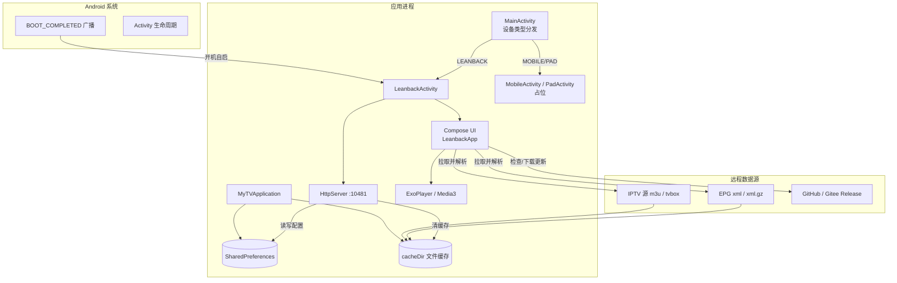

# 01 项目概览

## 1. 项目定位

「我的电视」是一个使用 Android 原生技术开发的**电视直播播放器**，主要解决 Flutter 版本（[my_tv](https://github.com/yaoxieyoulei/my_tv)）在低端电视设备上播放 4K 视频卡顿、掉帧的问题。项目仅支持 Android 5.0 及以上，默认直播源以 IPv6 为主，界面与交互围绕**遥控器**设计，同时兼容触摸屏手势。

核心能力：

- 直播源解析：支持 **M3U**、**TVBox**（`#genre#`）两种文本格式，未知格式降级提示。
- 节目单（EPG）：支持 `.xml`、`.xml.gz`，按频道过滤并缓存为 JSON。
- 多订阅源 / 多节目单：保存历史列表，可在设置中快速切换。
- 多线路：同一频道多个播放地址，自动/手动切换，记忆可播放域名。
- 频道收藏、数字选台、换台反转、开机自启、自动更新、画中画。
- 内置 HTTP 配置服务（`http://<设备IP>:10481`），浏览器端修改源地址、UA、查看日志、上传 APK。
- 播放失败自动换源、断线重连、超时检测、画面比例切换。

## 2. 功能清单与实现位置

| 功能 | 主要实现 |
| --- | --- |
| 直播源拉取与解析 | [IptvRepository](../app/src/main/java/top/yogiczy/mytv/data/repositories/iptv/IptvRepository.kt)、[parsers](../app/src/main/java/top/yogiczy/mytv/data/repositories/iptv/parser/IptvParser.kt) |
| 节目单拉取与解析 | [EpgRepository](../app/src/main/java/top/yogiczy/mytv/data/repositories/epg/EpgRepository.kt)、[fetchers](../app/src/main/java/top/yogiczy/mytv/data/repositories/epg/fetcher/EpgFetcher.kt) |
| 频道切换 / 多线路 | [MainContentState](../app/src/main/java/top/yogiczy/mytv/ui/screens/leanback/main/components/MainContentState.kt) |
| 播放控制 | [LeanbackVideoPlayerState](../app/src/main/java/top/yogiczy/mytv/ui/screens/leanback/video/VideoPlayerState.kt)、[LeanbackMedia3VideoPlayer](../app/src/main/java/top/yogiczy/mytv/ui/screens/leanback/video/player/Media3VideoPlayer.kt) |
| 选台面板（新版） | [PanelScreen](../app/src/main/java/top/yogiczy/mytv/ui/screens/leanback/panel/PanelScreen.kt) |
| 选台面板（经典） | [ClassicPanelScreen](../app/src/main/java/top/yogiczy/mytv/ui/screens/leanback/classicpanel/ClassicPanelScreen.kt) |
| 快捷面板 | [QuickPanelScreen](../app/src/main/java/top/yogiczy/mytv/ui/screens/leanback/quickpanel/QuickPanelScreen.kt) |
| 设置界面 | [SettingsScreen](../app/src/main/java/top/yogiczy/mytv/ui/screens/leanback/settings/SettingsScreen.kt) |
| 自动更新 | [UpdateViewModel](../app/src/main/java/top/yogiczy/mytv/ui/screens/leanback/update/UpdateViewModel.kt)、[GitRepository](../app/src/main/java/top/yogiczy/mytv/data/repositories/git/GitRepository.kt) |
| 网页配置服务 | [HttpServer](../app/src/main/java/top/yogiczy/mytv/ui/utils/HttpServer.kt) |
| 开机自启 | [BootReceiver](../app/src/main/java/top/yogiczy/mytv/BootReceiver.kt) |
| 配置持久化 | [SP](../app/src/main/java/top/yogiczy/mytv/ui/utils/SP.kt) |
| 遥控器/触摸输入映射 | [ModifierUtils](../app/src/main/java/top/yogiczy/mytv/ui/utils/ModifierUtils.kt) |

## 3. 技术栈

| 分类 | 技术 / 库 | 用途 |
| --- | --- | --- |
| 语言与构建 | Kotlin 2.0.0、AGP 8.5.0、Gradle 8.7、JDK 17 | 编译与打包 |
| UI | Jetpack Compose（BOM 2024.06.00）、Material 3 | 声明式 UI |
| TV 适配 | `androidx.tv:tv-foundation`、`androidx.tv:tv-material` | 焦点、`TvLazyRow/Column`、TV 组件 |
| 播放 | `androidx.media3:media3-exoplayer(-hls/-rtsp)` | 直播/HLS/RTSP 播放 |
| 解码扩展 | `app/libs/lib-decoder-ffmpeg-release.aar` | 软解不支持的音视频编码 |
| 网络 | OkHttp、AndroidAsync | 数据拉取、内置 HTTP 服务 |
| 序列化 | kotlinx.serialization | EPG JSON 缓存、设置接口 |
| 二维码 | qrose | 设置页二维码、更新页二维码 |
| 集合 | kotlinx-collections-immutable | Compose 稳定性优化 |
| 图标 | material-icons-extended | TV 设置分类图标 |
| 测试 | JUnit、Espresso、Compose UI Test | 当前仅模板测试 |

## 4. 仓库目录结构

```
mytv-android/
├── app/
│   ├── build.gradle.kts              # 应用模块构建脚本（签名、依赖、ABI）
│   ├── libs/
│   │   └── lib-decoder-ffmpeg-release.aar  # FFmpeg 解码扩展
│   └── src/
│       ├── main/
│       │   ├── AndroidManifest.xml   # 组件、权限、网络配置
│       │   ├── java/top/yogiczy/mytv/
│       │   │   ├── AppGlobal.kt      # 全局缓存目录
│       │   │   ├── MyTVApplication.kt# Application 初始化
│       │   │   ├── BootReceiver.kt   # 开机自启
│       │   │   ├── UnsafeTrustManager.kt # 忽略证书校验
│       │   │   ├── activities/       # 4 个 Activity 入口
│       │   │   ├── data/
│       │   │   │   ├── entities/     # 领域模型
│       │   │   │   ├── repositories/ # IPTV/EPG/Git 仓库与缓存
│       │   │   │   └── utils/        # 常量
│       │   │   ├── ui/
│       │   │   │   ├── LeanbackApp.kt
│       │   │   │   ├── screens/leanback/  # Compose 界面
│       │   │   │   ├── theme/        # TV/手机/平板主题
│       │   │   │   └── utils/        # SP、HttpServer、输入修饰符
│       │   │   └── utils/            # Logger、Downloader、ApkInstaller 等
│       │   └── res/
│       │       ├── raw/              # 网页配置页（index.html/css/js）
│       │       └── xml/              # FileProvider、网络安全配置
│       ├── test/                     # 单元测试模板
│       └── androidTest/              # Instrumentation 测试模板
├── gradle/libs.versions.toml         # 版本目录
├── .github/workflows/release.yml     # Tag 触发自动打包发布
├── CHANGELOG.md / README.md / LICENSE
└── screenshots/                      # 应用截图
```

> 说明：`MobileActivity` 与 `PadActivity` 目前仅为占位页面，实际可用界面集中在 Leanback（电视）端。`MainActivity` 虽实现了按 `SP.appDeviceDisplayType` 分发，但 `AndroidManifest.xml` 中只有 `LeanbackActivity` 声明了 `LAUNCHER` / `LEANBACK_LAUNCHER`，因此实际启动入口始终是 `LeanbackActivity`。

## 5. 运行时组件图



## 6. 包名与命名约定

- 根包：`top.yogiczy.mytv`，按 `activities / data / ui / utils` 划分。
- UI 组件统一加 `Leanback` 前缀（如 `LeanbackMainScreen`），以区分未来手机/平板实现。
- 数据模型以 `data class` + `List` 委托实现不可变集合（如 `IptvList : List<Iptv> by value`）。
- 仓库类均位于 `data/repositories/<domain>`，解析策略位于其 `parser/` 或 `fetcher/` 子包。
- 配置键集中在 `SP.KEY` 枚举，通过 `SP` 的属性扩展访问。

## 7. 版本与发布

- 当前版本 `1.4.4`，更新历史见 [CHANGELOG.md](../CHANGELOG.md)。
- CI 在推送 `v*.*.*` Tag 时构建 `assembleRelease` 并创建 GitHub Release，详见 [07-构建与运行](07-构建与运行.md)。

下一篇：[02 架构总览](02-架构总览.md)
