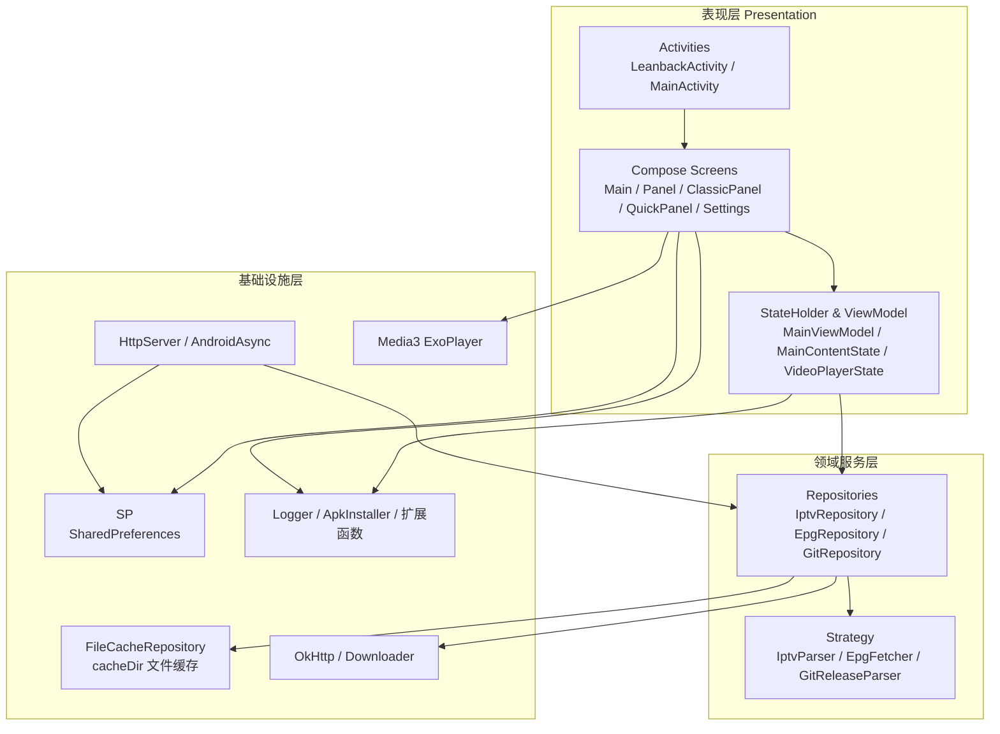
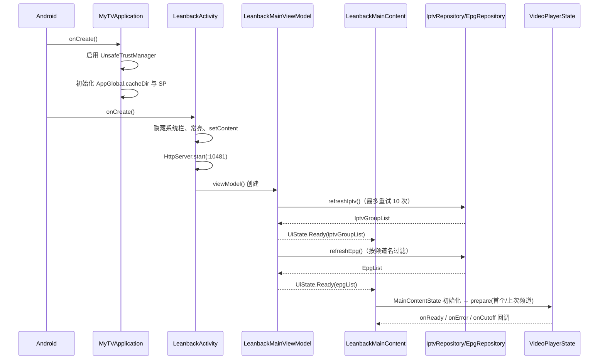
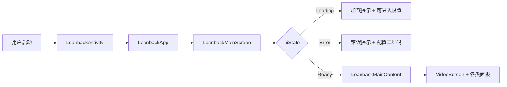
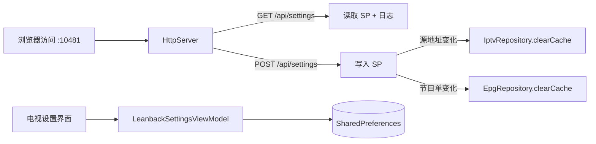

# 02 架构总览

## 1. 分层结构

项目未引入依赖注入框架与导航框架，整体采用「单 Activity + Compose 状态提升 + 手动创建仓库」的轻量结构：



### 1.1 各层职责

| 层 | 职责 | 代表类 |
| --- | --- | --- |
| 表现层 | 渲染电视 UI、处理遥控器/触摸、维护界面可见性状态 | `LeanbackApp`、`LeanbackMainScreen`、`LeanbackMainContent` |
| 状态层 | 将仓库数据转换为可观察状态，驱动 Compose 重组 | `LeanbackMainViewModel`、`LeanbackMainContentState`、`LeanbackVideoPlayerState`、`LeanbackSettingsViewModel` |
| 领域服务层 | 拉取远程数据、选择解析策略、业务规则（重试、过滤、去重） | `IptvRepository`、`EpgRepository`、`GitRepository` |
| 基础设施层 | 文件缓存、配置持久化、网络、播放、日志、安装 | `FileCacheRepository`、`SP`、`HttpServer`、`Logger` |

## 2. 模块职责

| 包/文件 | 职责 | 关键类 |
| --- | --- | --- |
| `top.yogiczy.mytv` | 应用级初始化与全局变量 | [MyTVApplication](../app/src/main/java/top/yogiczy/mytv/MyTVApplication.kt)、[AppGlobal](../app/src/main/java/top/yogiczy/mytv/AppGlobal.kt)、[BootReceiver](../app/src/main/java/top/yogiczy/mytv/BootReceiver.kt) |
| `activities` | 入口分发、沉浸式窗口、画中画、启动 HTTP 服务 | `MainActivity`、`LeanbackActivity` |
| `data.entities` | 直播源、节目单、版本信息的不可变模型 | `Iptv`、`IptvGroup`、`Epg`、`EpgProgramme`、`GitRelease` |
| `data.repositories` | 远程数据获取、缓存、解析 | `IptvRepository`、`EpgRepository`、`GitRepository`、`FileCacheRepository` |
| `data.utils` | 默认地址、超时、重试等常量 | `Constants` |
| `ui` | 应用根 Composable、双击退出、内边距 | `LeanbackApp` |
| `ui.screens.leanback.main` | 主界面与启动加载状态 | `LeanbackMainScreen`、`LeanbackMainViewModel`、`LeanbackMainContent`、`LeanbackMainContentState` |
| `ui.screens.leanback.video` | 视频渲染、播放状态、错误提示、元数据 | `LeanbackVideoScreen`、`LeanbackVideoPlayerState`、`LeanbackMedia3VideoPlayer` |
| `ui.screens.leanback.panel` | 新版选台面板、数字选台、临时频道信息、时间显示 | `LeanbackPanelScreen`、`LeanbackPanelTempScreen`、`LeanbackPanelDateTimeScreen` |
| `ui.screens.leanback.classicpanel` | 经典三栏选台（分组/频道/节目单） | `LeanbackClassicPanelScreen` |
| `ui.screens.leanback.quickpanel` | 长按 OK/菜单键呼出的快捷面板 | `LeanbackQuickPanelScreen` |
| `ui.screens.leanback.settings` | 12 类设置页与设置状态镜像 | `LeanbackSettingsScreen`、`LeanbackSettingsViewModel` |
| `ui.screens.leanback.toast` | 全局 Toast（自定义 Compose 弹层） | `LeanbackToastState`、`LeanbackToastScreen` |
| `ui.screens.leanback.update` | 检查更新、下载 APK、触发安装 | `LeanBackUpdateViewModel`、`LeanbackUpdateScreen` |
| `ui.screens.leanback.monitor` | 调试 FPS 悬浮层 | `LeanbackMonitorScreen` |
| `ui.theme` | 深色主题（同时配置 Material3 与 TV Material3） | `LeanbackTheme` |
| `ui.utils` | SharedPreferences 封装、HTTP 服务、输入手势修饰符 | `SP`、`HttpServer`、`handleLeanbackKeyEvents` |
| `utils` | 日志、下载、APK 安装、版本比较、时间格式化 | `Logger`、`Downloader`、`ApkInstaller`、`compareVersion` |

## 3. 应用启动时序



关键点：

1. `MainViewModel` 在 `init` 中顺序执行 `refreshIptv()`、`refreshEpg()`；EPG 只在直播源就绪后加载。
2. 直播源失败会重试 `Constants.HTTP_RETRY_COUNT = 10` 次，间隔 3 秒；失败后进入 `Error` 状态并把当前源移出历史列表。
3. 节目单失败只降级为空列表，不影响直播播放。
4. UI 的加载/错误页仍可通过菜单键打开设置，错误页右下角展示配置网页二维码。

## 4. 核心数据流

### 4.1 启动加载流



### 4.2 换台与播放流

```mermaid
flowchart TB
    K[按键/手势/面板点击] --> M[MainContentState.changeCurrentIptv]
    M --> N[更新 currentIptv / urlIdx / SP 上次频道]
    N --> O[选择线路：优先可播放域名]
    O --> P[VideoPlayerState.prepare(url)]
    P --> Q[ExoPlayer 准备并播放]
    Q -->|onReady| R[1.5s 后隐藏临时面板<br/>记录可播放 host]
    Q -->|onError| S[切换到下一条线路<br/>移除失败 host]
    Q -->|onCutoff| T[重新 prepare 当前线路]
```

### 4.3 配置修改流



## 5. 状态管理方式

| 状态 | 归属 | 实现 |
| --- | --- | --- |
| 应用级配置 | `SP` 单例 | `SharedPreferences`，键名为枚举 `SP.KEY` 的 `name` |
| 启动加载状态 | `LeanbackMainViewModel` | `MutableStateFlow<LeanbackMainUiState>` + `collectAsState()` |
| 频道与线路 | `LeanbackMainContentState` | `mutableStateOf` / `mutableIntStateOf`，`@Stable` 类 |
| 面板可见性 | `LeanbackMainContentState` | `isPanelVisible` / `isSettingsVisible` / `isTempPanelVisible` / `isQuickPanelVisible` |
| 播放器状态 | `LeanbackVideoPlayerState` | `mutableStateOf` + 监听器列表 |
| 播放器底层 | `LeanbackVideoPlayer` | 抽象类 + 回调监听器注册 |
| 设置页 | `LeanbackSettingsViewModel` | 每个配置项一个 `mutableStateOf`，setter 写回 SP |
| Toast | `LeanbackToastState` | 伴生对象 `I` 暴露全局单例 |

> 注意：`LeanbackToastState.I` 采用静态单例 + Compose `remember` 初始化，源码注释已标注“可能违反 Compose 规则”，属于已知设计取舍。

## 6. 并发与线程

| 场景 | 调度 | 位置 |
| --- | --- | --- |
| 直播源/节目单网络请求 | `Dispatchers.IO` | `IptvRepository.fetchSource`、`EpgRepository.fetchXml` |
| XML 解析 | `Dispatchers.Default` | `EpgRepository.parseFromXml` |
| 文件读写 | `Dispatchers.IO` | `FileCacheRepository` |
| 播放器回调 | 主线程 | ExoPlayer 内部 |
| 下载进度 | `Dispatchers.IO` | `Downloader` |
| HTTP 服务 | `Dispatchers.IO` + AndroidAsync 事件循环 | `HttpServer.start` |

## 7. 关键设计模式

| 模式 | 体现 | 收益 |
| --- | --- | --- |
| 策略模式 | `IptvParser.instances`、`EpgFetcher.instances`、`GitReleaseParser.instances` | 新增格式只需实现接口并注册到列表 |
| 模板方法 | `FileCacheRepository.getOrRefresh(...)` | 统一“读缓存 → 判断过期 → 刷新 → 写缓存”流程 |
| 观察者模式 | `LeanbackVideoPlayer` 的 `onReady/onError/onCutoff/onMetadata` 监听器 | 解耦播放内核与业务逻辑 |
| 状态提升 | `LeanbackMainContent` 汇总各面板 Provider | UI 通过 `() -> T` 惰性读取状态，减少无谓重组 |
| 单例 / 全局对象 | `SP`、`HttpServer`、`Logger.history`、`AppGlobal` | 简化跨组件访问（代价是隐式依赖） |
| 适配器 | `IptvList`、`EpgList` 通过 `by value` 实现 `List` | 保持不可变语义同时复用集合 API |

## 8. 错误处理策略

| 场景 | 行为 |
| --- | --- |
| 直播源请求失败 | `retryWhen` 最多 10 次、间隔 3s；最终 `Error` 状态并展示错误信息 |
| 节目单请求失败 | 重试后 `catch` 返回空 `EpgList`，不影响播放 |
| 未知直播源格式 | `DefaultIptvParser` 返回提示分组（“不支持当前直播源链接格式”） |
| 未知 EPG 格式 | `DefaultEpgFetcher` 返回空 XML 声明 |
| 播放器错误 | 优先切换下一线路；特定错误尝试换容器或跳直播窗口 |
| 播放卡住 | 位置 15s 未变化触发 `onCutoff` 重新准备 |
| 更新检查失败 | 记录日志，不打扰用户 |
| HTTP 服务启动失败 | Toast 提示“设置服务启动失败” |

## 9. 安全与网络说明

- `AndroidManifest` 开启 `usesCleartextTraffic="true"`，`network_security_config.xml` 允许明文流量。
- `UnsafeTrustManager` 全局信任所有 HTTPS 证书并跳过主机名校验，用于兼容证书异常的直播源；属于**有意降低安全性**的实现，二次开发时需注意。
- 内置 HTTP 服务监听 `10481` 端口，无鉴权，仅应部署在可信局域网。

下一篇：[03 数据层](03-数据层.md)
