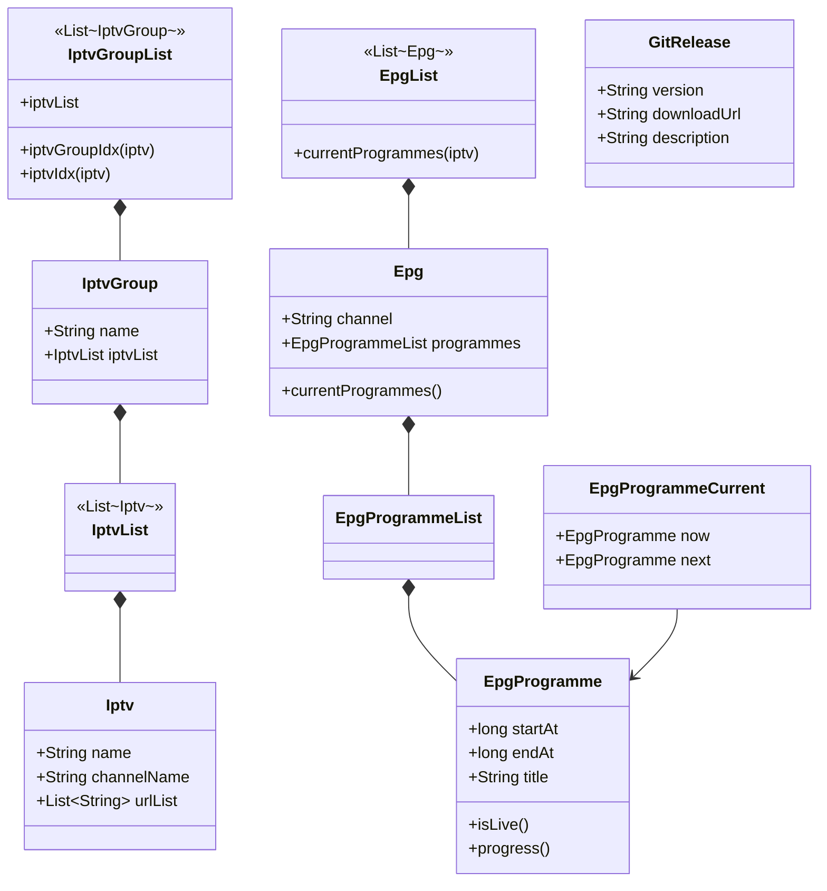
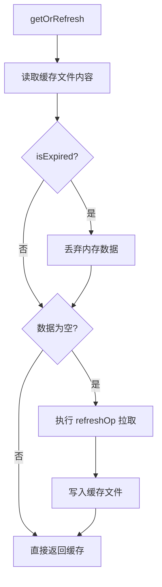

# 03 数据层

数据层位于 `app/src/main/java/top/yogiczy/mytv/data/`，负责三件事：**定义领域模型**、**拉取远程数据**、**解析并缓存**。



## 1. 实体模型（entities）

### 1.1 直播源

| 类 | 字段 | 说明 |
| --- | --- | --- |
| [Iptv](../app/src/main/java/top/yogiczy/mytv/data/entities/Iptv.kt) | `name` | 频道显示名（如 `CCTV-1`） |
| | `channelName` | 用于匹配 EPG 的频道名（m3u 取 `tvg-name`） |
| | `urlList` | 同一频道的多条播放地址（多线路） |
| [IptvGroup](../app/src/main/java/top/yogiczy/mytv/data/entities/IptvGroup.kt) | `name`、`iptvList` | 频道分组（如“央视”“卫视”） |
| [IptvList](../app/src/main/java/top/yogiczy/mytv/data/entities/IptvList.kt) | `value` | 通过 `List<Iptv> by value` 实现只读列表，`@Immutable` |
| [IptvGroupList](../app/src/main/java/top/yogiczy/mytv/data/entities/IptvGroupList.kt) | `value` | 分组列表 + 三个扩展工具 |

`IptvGroupList` 伴生对象中的扩展：

| 函数 / 属性 | 作用 |
| --- | --- |
| `IptvGroupList.iptvGroupIdx(iptv)` | 返回频道所在分组下标；未找到为 `-1` |
| `IptvGroupList.iptvIdx(iptv)` | 返回频道在**扁平化所有分组**后的全局下标 |
| `IptvGroupList.iptvList` | 扁平化得到全部 `Iptv` |

> 全局序号即界面展示的频道号（从 1 开始），数字选台与“上次频道”恢复都依赖它。

### 1.2 节目单

| 类 | 字段 | 说明 |
| --- | --- | --- |
| [Epg](../app/src/main/java/top/yogiczy/mytv/data/entities/Epg.kt) | `channel`、`programmes` | 单个频道的节目单，`@Serializable` 便于 JSON 缓存 |
| [EpgProgramme](../app/src/main/java/top/yogiczy/mytv/data/entities/EpgProgramme.kt) | `startAt`、`endAt`、`title` | 时间戳（毫秒） |
| [EpgProgrammeCurrent](../app/src/main/java/top/yogiczy/mytv/data/entities/EpgProgrammeCurrent.kt) | `now`、`next` | 当前/下一个节目 |
| [EpgProgrammeList](../app/src/main/java/top/yogiczy/mytv/data/entities/EpgProgrammeList.kt) | `value` | 节目列表包装 |
| [EpgList](../app/src/main/java/top/yogiczy/mytv/data/entities/EpgList.kt) | `value` | 频道节目单集合 |

关键函数：

```kotlin
// Epg.kt
fun Epg.currentProgrammes(): EpgProgrammeCurrent? {
    val currentProgramme = programmes.firstOrNull { it.isLive() } ?: return null
    return EpgProgrammeCurrent(
        now = currentProgramme,
        next = programmes.indexOf(currentProgramme).let { index ->
            if (index + 1 < programmes.size) programmes[index + 1] else null
        },
    )
}

// EpgProgramme.kt
fun EpgProgramme.isLive() = System.currentTimeMillis() in startAt..<endAt
fun EpgProgramme.progress() =
    (System.currentTimeMillis() - startAt).toFloat() / (endAt - startAt)

// EpgList.kt
fun EpgList.currentProgrammes(iptv: Iptv) =
    firstOrNull { it.channel == iptv.channelName }?.currentProgrammes()
```

| 函数 | 说明 |
| --- | --- |
| `Epg.currentProgrammes()` | 找到第一个正在播出的节目，并附带下一个节目 |
| `EpgList.currentProgrammes(iptv)` | 按 `iptv.channelName == epg.channel` 匹配后取当前节目 |
| `EpgProgramme.isLive()` | 当前时间是否处于 `[startAt, endAt)` |
| `EpgProgramme.progress()` | 返回 0~1 的播放进度，用于进度条 |

### 1.3 版本信息

[GitRelease](../app/src/main/java/top/yogiczy/mytv/data/entities/GitRelease.kt)：`version`、`downloadUrl`、`description`，由 Git 仓库解析器填充。

## 2. 缓存基类：FileCacheRepository

[FileCacheRepository](../app/src/main/java/top/yogiczy/mytv/data/repositories/FileCacheRepository.kt) 是所有文件缓存的模板基类，缓存目录来自 [AppGlobal.cacheDir](../app/src/main/java/top/yogiczy/mytv/AppGlobal.kt)（即 `context.cacheDir`）。

```kotlin
abstract class FileCacheRepository(private val fileName: String) {
    protected suspend fun getOrRefresh(
        cacheTime: Long,
        refreshOp: suspend () -> String
    ): String

    protected suspend fun getOrRefresh(
        isExpired: (lastModified: Long, cacheData: String?) -> Boolean,
        refreshOp: suspend () -> String
    ): String

    fun clearCache()
}
```

执行流程：



| 方法 | 说明 |
| --- | --- |
| `getOrRefresh(cacheTime, refreshOp)` | 基于文件 `lastModified` 判断是否超过缓存时长 |
| `getOrRefresh(isExpired, refreshOp)` | 自定义过期策略（EPG 用于“跨天刷新”） |
| `clearCache()` | 删除缓存文件；HTTP 设置变更时调用 |

### 2.1 缓存文件一览

| 文件 | 所属仓库 | 内容 | 过期策略 |
| --- | --- | --- | --- |
| `iptv.txt` | `IptvRepository` | 直播源原始文本 | `SP.iptvSourceCacheTime`，默认 24 小时 |
| `epg.xml` | `EpgXmlRepository`（私有类） | 解压后的 EPG XML 文本 | 传入 `0`，即每次请求都会刷新 |
| `epg.json` | `EpgRepository` | 解析后的 `List<Epg>` JSON | 日期变化时刷新（每天一次） |

> 设计上 `epg.xml` 作为“原始 XML 缓存”，`epg.json` 作为“解析结果缓存”。由于 `getEpgXml()` 使用 `getOrRefresh(0)`，实际每次加载都会重新下载 XML；真正的按天缓存由 `epg.json` 承担。

## 3. 直播源仓库：IptvRepository

[IptvRepository](../app/src/main/java/top/yogiczy/mytv/data/repositories/iptv/IptvRepository.kt) 继承 `FileCacheRepository("iptv.txt")`。

| 成员 | 说明 |
| --- | --- |
| `fetchSource(sourceUrl)` | OkHttp GET，非 2xx 抛异常；网络异常统一包装为“获取远程直播源失败，请检查网络连接” |
| `simplifyTest(group, iptv)` | 精简模式过滤：名称以 `cctv` 开头或以“卫视”结尾 |
| `getIptvGroupList(sourceUrl, cacheTime, simplify = false)` | 核心入口：读缓存/远程拉取 → 选择解析器 → 解析 →（可选）精简 |

解析器选择：

```kotlin
val parser = IptvParser.instances.first { it.isSupport(sourceUrl, sourceData) }
```

### 3.1 解析策略

接口 [IptvParser](../app/src/main/java/top/yogiczy/mytv/data/repositories/iptv/parser/IptvParser.kt)：

```kotlin
interface IptvParser {
    fun isSupport(url: String, data: String): Boolean
    suspend fun parse(data: String): IptvGroupList

    companion object {
        val instances = listOf(M3uIptvParser(), TvboxIptvParser(), DefaultIptvParser())
    }
}
```

| 解析器 | 判定条件 | 说明 |
| --- | --- | --- |
| [M3uIptvParser](../app/src/main/java/top/yogiczy/mytv/data/repositories/iptv/parser/M3uIptvParser.kt) | 文本以 `#EXTM3U` 开头 | 读取 `#EXTINF` 行，取 `tvg-name` 作为 `channelName`、`group-title` 作为分组，下一行作为 URL |
| [TvboxIptvParser](../app/src/main/java/top/yogiczy/mytv/data/repositories/iptv/parser/TvboxIptvParser.kt) | 文本包含 `#genre#` | `分组名,#genre#` 定义分组；`频道名,url1#url2` 定义频道与多线路；兼容中文逗号 `，` |
| [DefaultIptvParser](../app/src/main/java/top/yogiczy/mytv/data/repositories/iptv/parser/DefaultIptvParser.kt) | 恒为 `true`，兜底 | 返回“不支持当前直播源链接格式”的提示分组 |

两个真实解析器的输出结构一致：

1. 先按**分组名**归并；
2. 再按**频道名**归并；
3. 同一频道的多个 URL 合并进 `urlList`，`channelName` 取第一条。

M3U 解析伪代码：

```
逐行扫描：
  若行以 #EXTINF 开头：
    name        = 逗号后的最后一段
    channelName = tvg-name="..." 或 name
    groupName   = group-title="..." 或 "其他"
    url         = 下一行
  groupBy(groupName) → groupBy(name) → 合并 urlList
```

TvBox 解析伪代码：

```
逐行扫描：
  空行或 # 开头 → 跳过
  含 #genre# → 更新当前 groupName
  否则按逗号拆分 → 频道名 = 第 1 段
    URL 字段按 # 拆分 → 多个线路
  groupBy(groupName) → groupBy(name) → 合并 urlList
```

### 3.2 精简模式

当 `SP.iptvSourceSimplify = true` 时，仅保留：

- 名称以 `cctv` 开头（忽略大小写）；
- 名称以“卫视”结尾。

空分组会被移除。

## 4. 节目单仓库：EpgRepository

[EpgRepository](../app/src/main/java/top/yogiczy/mytv/data/repositories/epg/EpgRepository.kt) 继承 `FileCacheRepository("epg.json")`，内部还包含私有类 `EpgXmlRepository`（`epg.xml`）。

### 4.1 入口函数

```kotlin
suspend fun getEpgList(
    xmlUrl: String,
    filteredChannels: List<String> = emptyList(),
    refreshTimeThreshold: Int,
): EpgList
```

执行逻辑：

1. 若当前小时 `< refreshTimeThreshold`（默认 2 点），直接返回空 `EpgList`，避免凌晨无效刷新。
2. 读取/刷新 `epg.json`；过期判断为“`yyyy-MM-dd` 日期与缓存文件修改日期不同”。
3. 过期时调用 `epgXmlRepository.getEpgXml(xmlUrl)` 获取 XML，解析后序列化为 JSON。
4. 最终反序列化为 `EpgList`。

### 4.2 XML 获取策略

接口 [EpgFetcher](../app/src/main/java/top/yogiczy/mytv/data/repositories/epg/fetcher/EpgFetcher.kt)：

| 实现 | 支持条件 | 行为 |
| --- | --- | --- |
| [XmlEpgFetcher](../app/src/main/java/top/yogiczy/mytv/data/repositories/epg/fetcher/XmlEpgFetcher.kt) | URL 以 `.xml` 结尾 | 直接读取响应字符串 |
| [XmlGzEpgFetcher](../app/src/main/java/top/yogiczy/mytv/data/repositories/epg/fetcher/XmlGzEpgFetcher.kt) | URL 以 `.gz` 结尾 | `GZIPInputStream` 解压后逐行转字符串 |
| [DefaultEpgFetcher](../app/src/main/java/top/yogiczy/mytv/data/repositories/epg/fetcher/DefaultEpgFetcher.kt) | 恒为 `true` | 返回空 XML 声明，避免崩溃 |

### 4.3 XML 解析算法

使用 `XmlPullParser` 流式解析，单次扫描文档，只关心两类标签：

| 标签 | 处理 |
| --- | --- |
| `<channel id="...">` | 读取 `id`，`nextText()` 得到频道名；若频道名在 `filteredChannels` 中（或过滤列表为空）则创建 `Epg` |
| `<programme channel="..." start="..." stop="...">` | 读取频道 `id`、开始/结束时间与标题，追加到对应 `Epg.programmes` |

时间格式为 `yyyyMMddHHmmss Z`（长度小于 14 直接记为 0）；频道过滤条件来自直播源的 `channelName` 集合，因此**只解析当前订阅源实际用到的频道**，显著降低内存与耗时。

### 4.4 相关常量

| 常量 | 默认值 | 说明 |
| --- | --- | --- |
| `Constants.EPG_XML_URL` | `http://epg.51zmt.top:8000/e.xml.gz` | 默认节目单地址 |
| `Constants.EPG_REFRESH_TIME_THRESHOLD` | `2` | 凌晨 2 点前不刷新 |
| `SP.epgEnable` | `true` | 是否启用节目单 |
| `SP.epgXmlUrl` | 空 → 使用默认地址 | 用户自定义节目单 |
| `SP.epgXmlUrlHistoryList` | 空集合 | 历史节目单列表 |

## 5. 版本仓库：GitRepository

[GitRepository](../app/src/main/java/top/yogiczy/mytv/data/repositories/git/GitRepository.kt) 通过 GitHub/Gitee Release API 获取最新版本：

```kotlin
suspend fun latestRelease(url: String): GitRelease
```

流程：OkHttp GET → `GitReleaseParser.instances.first { it.isSupport(url) }` → `parse(body)`。

| 解析器 | 支持条件 | 特殊处理 |
| --- | --- | --- |
| [GithubGitReleaseParser](../app/src/main/java/top/yogiczy/mytv/data/repositories/git/parser/GithubGitReleaseParser.kt) | URL 含 `github.com` | 下载地址拼接 `Constants.GITHUB_PROXY` 加速前缀 |
| [GiteeGitReleaseParser](../app/src/main/java/top/yogiczy/mytv/data/repositories/git/parser/GiteeGitReleaseParser.kt) | URL 含 `gitee.com` | 不加代理 |

解析字段：

- `version` ← `tag_name` 去掉首字符 `v`；
- `downloadUrl` ← `assets[0].browser_download_url`；
- `description` ← `body`。

> 若 Release 没有上传 assets，`assets[0]` 会抛异常，更新检查会被 `UpdateViewModel` 捕获并记录日志。

## 6. 通用扩展函数

[ExtensionUtils](../app/src/main/java/top/yogiczy/mytv/utils/ExtensionUtils.kt)：

| 函数 | 说明 |
| --- | --- |
| `Long.humanizeMs()` | 将毫秒转为“秒/分钟/小时”中文描述，用于设置页展示重试间隔 |
| `String.isIPv6()` | 正则判断 URL 是否为 IPv6 字面量地址 |
| `String.compareVersion(other)` | 语义化版本比较：按 `.` 拆分数值、缺位补 0，再比较 `-` 后的预发布标签；返回 1/0/-1 |

## 7. 注意事项与已知取舍

1. **无统一错误类型**：仓库层直接抛 `Exception` 并附带中文消息，UI 通过 `message` 展示。
2. **`Iptv.urlList` 可能为空**：未知格式兜底分组中的频道没有 URL，播放层使用前需保证列表非空。
3. **M3U 解析的边界**：parser 直接读取 `#EXTINF` 的下一行作为 URL，若 `#EXTINF` 是文件最后一行会越界；频道名取逗号分隔的最后一段，名称本身含逗号时会被截断。
4. **EPG 对标签顺序敏感**：解析器只会把 `<programme>` 关联到已解析出的 `<channel>`，若 XML 中节目先于频道定义出现，该节目会被丢弃。
5. **缓存目录会被整体清空**：快捷面板“清除缓存”会 `deleteRecursively()` 删除整个 `cacheDir`，包括下载中的更新包。
6. **EPG 过滤只匹配 `channelName`**：M3U 的 `tvg-name` 与 EPG 的 `display-name` 必须一致，否则无法显示节目。
7. **EPG 凌晨不加载**：`refreshTimeThreshold = 2` 时，凌晨 0~2 点启动应用不会显示节目单。

下一篇：[04 播放与选台](04-播放与选台.md)
