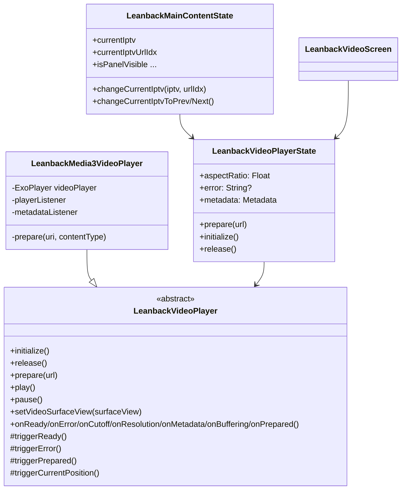
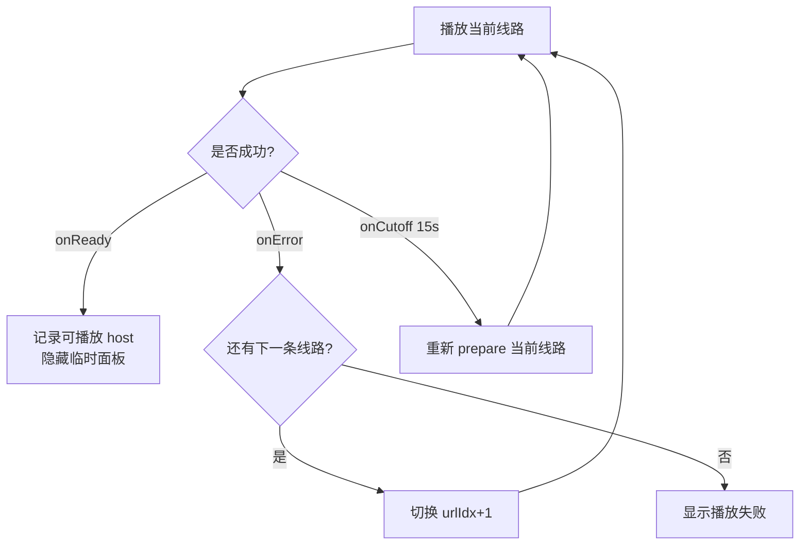

# 04 播放与选台

播放模块由三层组成：

1. **播放内核层**：[LeanbackVideoPlayer](../app/src/main/java/top/yogiczy/mytv/ui/screens/leanback/video/player/VideoPlayer.kt)（抽象）+ [LeanbackMedia3VideoPlayer](../app/src/main/java/top/yogiczy/mytv/ui/screens/leanback/video/player/Media3VideoPlayer.kt)（ExoPlayer 实现）；
2. **播放状态层**：[LeanbackVideoPlayerState](../app/src/main/java/top/yogiczy/mytv/ui/screens/leanback/video/VideoPlayerState.kt)，把回调转为 Compose 状态；
3. **选台业务层**：[LeanbackMainContentState](../app/src/main/java/top/yogiczy/mytv/ui/screens/leanback/main/components/MainContentState.kt)，处理频道/线路切换、可播放域名记忆、自动换源。



## 1. 播放器抽象：LeanbackVideoPlayer

抽象基类只负责**回调分发**与**超时/卡顿检测**，具体播放能力由子类实现。

### 1.1 抽象接口

| 方法 | 说明 |
| --- | --- |
| `initialize()` | 初始化并清空监听器 |
| `release()` | 释放资源并清空监听器 |
| `prepare(url)` | 准备指定地址 |
| `play()` / `pause()` | 播放控制 |
| `setVideoSurfaceView(surfaceView)` | 绑定渲染 Surface |

### 1.2 回调注册

| 注册方法 | 回调类型 | 触发时机 |
| --- | --- | --- |
| `onResolution` | `(width, height) -> Unit` | 视频尺寸变化 |
| `onError` | `(PlaybackException?) -> Unit` | 播放错误；`null` 表示错误恢复/开始缓冲 |
| `onReady` | `() -> Unit` | 进入 `STATE_READY` |
| `onBuffering` | `(Boolean) -> Unit` | 缓冲状态变化 |
| `onPrepared` | `() -> Unit` | 媒体源准备完成 |
| `onMetadata` | `(Metadata) -> Unit` | 音视频格式/解码器信息更新 |
| `onCutoff` | `() -> Unit` | 播放位置长时间不变化（疑似断流） |

### 1.3 超时机制

基类内部维护两个 `Job`：

| 机制 | 实现 | 触发结果 |
| --- | --- | --- |
| 加载超时 | `triggerPrepared()` 启动 `delay(SP.videoPlayerLoadTimeout)`（默认 15s） | 触发 `PlaybackException.LOAD_TIMEOUT` |
| 断流/卡顿检测 | `triggerCurrentPosition(newPosition)` 每次位置变化都重置计时；超过超时时间位置未变 | 触发 `onCutoff` |

配套规则：

- `triggerReady()` 会取消加载超时；
- `triggerError()` 在非 `LOAD_TIMEOUT` 错误时取消加载超时，避免错误后再次误报；
- `triggerPrepared()` 同时取消旧的卡顿计时。

自定义错误类型：

```kotlin
data class PlaybackException(val errorCodeName: String, val errorCode: Int) : Exception(errorCodeName) {
    companion object {
        val UNSUPPORTED_TYPE = PlaybackException("UNSUPPORTED_TYPE", 10002)
        val LOAD_TIMEOUT     = PlaybackException("LOAD_TIMEOUT", 10003)
    }
}
```

### 1.4 元数据模型

`Metadata` 汇总用于调试浮层展示的信息：

| 分组 | 字段 |
| --- | --- |
| 视频 | `videoMimeType`、`videoWidth`、`videoHeight`、`videoColor`、`videoFrameRate`、`videoBitrate`、`videoDecoder` |
| 音频 | `audioMimeType`、`audioChannels`、`audioSampleRate`、`audioDecoder` |

## 2. Media3 实现：LeanbackMedia3VideoPlayer

### 2.1 播放器构建

```kotlin
ExoPlayer.Builder(
    context,
    DefaultRenderersFactory(context).setExtensionRendererMode(EXTENSION_RENDERER_MODE_ON)
).build().apply { playWhenReady = true }
```

- `EXTENSION_RENDERER_MODE_ON` 启用扩展渲染器，配合 `app/libs/lib-decoder-ffmpeg-release.aar` 实现软解兜底。
- 数据源使用 `DefaultHttpDataSource`，参数全部来自配置：

| 配置 | 来源 |
| --- | --- |
| User-Agent | `SP.videoPlayerUserAgent`（默认 `ExoPlayer`） |
| 连接/读取超时 | `SP.videoPlayerLoadTimeout` |
| 302 重定向保留 POST | `setKeepPostFor302Redirects(true)` |
| 跨协议重定向 | `setAllowCrossProtocolRedirects(true)` |

### 2.2 媒体类型与回退

`prepare(uri, contentType)` 依据 `Util.inferContentType(uri)` 或指定类型创建 MediaSource：

| 类型 | MediaSource |
| --- | --- |
| `C.CONTENT_TYPE_HLS` | `HlsMediaSource` |
| `C.CONTENT_TYPE_RTSP` | `RtspMediaSource` |
| `C.CONTENT_TYPE_OTHER` | `ProgressiveMediaSource` |
| 其他 | 触发 `UNSUPPORTED_TYPE`，不加载 |

`contentTypeAttempts` 记录已尝试过的容器类型，用于错误回退。

### 2.3 播放事件处理

| 事件 | 处理 |
| --- | --- |
| `onVideoSizeChanged` | `triggerResolution(width, height)` |
| `onPlayerError` `ERROR_CODE_BEHIND_LIVE_WINDOW` | `seekToDefaultPosition()` 后重新 `prepare()`，修复直播落后窗口 |
| `onPlayerError` `ERROR_CODE_PARSING_CONTAINER_UNSUPPORTED` | 依次尝试 `HLS` → `OTHER`（源码中分支有重复判断），全部失败则报 `UNSUPPORTED_TYPE` |
| 其他错误 | `triggerError(PlaybackException(errorCodeName, errorCode))` |
| `STATE_BUFFERING` | 清除错误显示并 `triggerBuffering(true)` |
| `STATE_READY` | `triggerReady()`，并启动每秒一次的播放位置轮询（用于卡顿检测） |
| 非缓冲状态 | `triggerBuffering(false)` |

### 2.4 元数据采集

通过 `AnalyticsListener` 获取：

- `onVideoInputFormatChanged` → 编码、宽高、色彩、帧率、比特率；
- `onVideoDecoderInitialized` → 视频解码器名；
- `onAudioInputFormatChanged` → 音频编码、声道、采样率；
- `onAudioDecoderInitialized` → 音频解码器名。

同时注册 `EventLogger` 输出 ExoPlayer 调试日志。

### 2.5 释放

`release()` 依次移除播放监听、元数据监听、EventLogger，再调用 `videoPlayer.release()` 与父类清理。

## 3. 播放状态：LeanbackVideoPlayerState

`@Stable` 类，持有播放器实例与 Compose 状态：

| 属性 | 类型 | 说明 |
| --- | --- | --- |
| `aspectRatio` | `Float` | 画面宽高比，默认 16:9，`mutableFloatStateOf` |
| `error` | `String?` | 错误文本，格式 `ERROR_CODE_NAME(code)` |
| `metadata` | `Metadata` | 播放元数据 |

监听器转发：

```kotlin
instance.onResolution { w, h -> aspectRatio = defaultAspectRatioProvider() ?: (w / h) }
instance.onError { ex -> error = "${ex.errorCodeName}(${ex.errorCode})"; onErrorListeners... }
instance.onReady { onReadyListeners.forEach { it() } }
instance.onBuffering { if (it) error = null }
instance.onMetadata { metadata = it }
instance.onCutoff { onCutoffListeners.forEach { it() } }
```

### 3.1 与生命周期绑定

`rememberLeanbackVideoPlayerState()`：

- `DisposableEffect(Unit)`：组合进入时 `initialize()`，离开时 `release()`；
- `DisposableEffect(lifecycleOwner)`：`ON_RESUME → play()`，`ON_STOP → pause()`，保证退后台暂停、回前台续播。

### 3.2 画面比例来源

`LeanbackMainContent` 通过 `defaultAspectRatioProvider` 把设置项映射为比例：

| 设置枚举 | 结果 |
| --- | --- |
| `ORIGINAL` | `null` → 使用视频原始宽高比 |
| `SIXTEEN_NINE` | `16f / 9f` |
| `FOUR_THREE` | `4f / 3f` |
| `AUTO` | `屏幕高度 / 屏幕宽度`（强制铺满，自动拉伸） |

`LeanbackVideoScreen` 用 `Modifier.aspectRatio(state.aspectRatio)` 控制 `SurfaceView` 显示比例。

## 4. 视频渲染与错误提示

[LeanbackVideoScreen](../app/src/main/java/top/yogiczy/mytv/ui/screens/leanback/video/VideoScreen.kt)：

- 使用 `SurfaceView` 而非 `PlayerView`，源码注释说明是为了避免切换视频时黑屏闪烁；
- `AndroidView.update` 中将 SurfaceView 交给 `state.setVideoSurfaceView()`；
- 叠加 `LeanbackVideoPlayerErrorScreen` 显示播放失败原因；
- 可选叠加 `LeanbackVideoPlayerMetadata` 调试信息。

[LeanbackVideoPlayerErrorScreen](../app/src/main/java/top/yogiczy/mytv/ui/screens/leanback/video/VideoPlayerErrorScreen.kt) 在 `state.error != null` 时居中显示“播放失败 + 错误码”。

## 5. 选台业务：LeanbackMainContentState

### 5.1 状态字段

| 字段 | 说明 |
| --- | --- |
| `currentIptv` | 当前频道 |
| `currentIptvUrlIdx` | 当前线路下标 |
| `isPanelVisible` | 选台面板可见 |
| `isSettingsVisible` | 设置界面可见 |
| `isTempPanelVisible` | 换台后的临时信息面板 |
| `isQuickPanelVisible` | 快捷面板可见 |

### 5.2 初始化与回调

```kotlin
init {
    changeCurrentIptv(
        iptvGroupList.iptvList.getOrElse(SP.iptvLastIptvIdx) {
            iptvGroupList.firstOrNull()?.iptvList?.firstOrNull() ?: Iptv()
        }
    )

    videoPlayerState.onReady {
        // 1.5 秒后若频道/线路未再变化，隐藏临时面板
        // 记录当前线路 host 到 SP.iptvPlayableHostList
    }

    videoPlayerState.onError {
        // 若还有下一条线路，自动切换
        // 从可播放 host 列表中移除
    }

    videoPlayerState.onCutoff {
        // 断流：重新 prepare 当前频道/线路
        changeCurrentIptv(_currentIptv, _currentIptvUrlIdx)
    }
}
```

### 5.3 频道切换算法

```kotlin
fun changeCurrentIptv(iptv: Iptv, urlIdx: Int? = null) {
    _isPanelVisible = false
    if (iptv == _currentIptv && urlIdx == null) return

    // 同一频道切换线路时，先移除旧 host
    if (iptv == _currentIptv && urlIdx != _currentIptvUrlIdx) {
        SP.iptvPlayableHostList -= getUrlHost(_currentIptv.urlList[_currentIptvUrlIdx])
    }

    _isTempPanelVisible = true
    _currentIptv = iptv
    SP.iptvLastIptvIdx = iptvGroupList.iptvIdx(_currentIptv)

    _currentIptvUrlIdx = if (urlIdx == null) {
        // 优先选择历史可播放的域名，否则第 0 条
        max(0, _currentIptv.urlList.indexOfFirst {
            SP.iptvPlayableHostList.contains(getUrlHost(it))
        })
    } else {
        (urlIdx + _currentIptv.urlList.size) % _currentIptv.urlList.size
    }

    videoPlayerState.prepare(iptv.urlList[_currentIptvUrlIdx])
}
```

要点：

1. **自动线路选择**：优先选择 `SP.iptvPlayableHostList` 中记录过的域名；
2. **线路循环**：显式传入的 `urlIdx` 通过取模实现首尾环绕（左/右方向键切换线路；
3. **记忆上次频道**：每次切换都写入 `SP.iptvLastIptvIdx`，下次启动恢复；
4. **临时面板**：切换后显示频道信息，播放成功 1.5s 后自动隐藏（若期间又换台则重新计时）。

> 注意：`urlList` 为空时 `urlList[idx]` 会抛越界异常，调用方需保证频道存在至少一条 URL。

### 5.4 上/下换台

`getPrevIptv()` / `getNextIptv()` 基于扁平频道列表查找：

- 上一台越界时回到**最后一个分组最后一个频道**；
- 下一台越界时回到**第一个分组第一个频道**；
- 是否反转由 `SP.iptvChannelChangeFlip` 决定（设置项“换台反转”）。

### 5.5 可播放域名记忆

`getUrlHost(url)` 截取 `scheme://host/path` 中的 host 部分：

```kotlin
private fun getUrlHost(url: String): String =
    url.split("://").getOrElse(1) { "" }.split("/").firstOrNull() ?: url
```

| 场景 | 行为 |
| --- | --- |
| 播放成功 `onReady` | host 加入 `SP.iptvPlayableHostList` |
| 播放错误 `onError` | host 移出列表 |
| 手动切换线路 | 旧线路 host 移出列表 |
| 下次选台 | 优先匹配列表中的 host |

> 实现细节：`onError` 触发时，`changeCurrentIptv` 内部会先移除**失败线路**的 host，随后 `onError` 回调又移除一次 `_currentIptvUrlIdx` 指向的 host。由于此时下标已切换到新线路，第二条移除实际作用于**新线路**；若已是最后一条线路，则只会移除当前失败线路。二次开发时如需精确记录失败域名，应调整这两步的顺序。

## 6. 多线路与自动换源



- **手动切线路**：左右方向键 / 屏幕左右滑动，仅在 `urlList.size > 1` 时生效；
- **自动换线路**：`onError` 且存在下一条线路时自动切换；
- **断流重连**：`onCutoff` 重新准备当前线路；
- **直播窗口错误**：Media3 层直接 `seekToDefaultPosition()` 重试。

## 7. 画中画（PiP）

[LeanbackActivity](../app/src/main/java/top/yogiczy/mytv/activities/LeanbackActivity.kt)：

```kotlin
override fun onUserLeaveHint() {
    if (Build.VERSION.SDK_INT < Build.VERSION_CODES.O) return
    if (!SP.uiPipMode) return
    enterPictureInPictureMode(
        PictureInPictureParams.Builder().setAspectRatio(Rational(16, 9)).build()
    )
    super.onUserLeaveHint()
}
```

- 仅在 Android 8.0+ 且设置开启时生效；
- `AndroidManifest` 中 `LeanbackActivity` 声明了 `supportsPictureInPicture="true"`；
- 默认关闭（`SP.uiPipMode` 默认 `false`）。

## 8. 相关常量

| 常量 | 值 | 用途 |
| --- | --- | --- |
| `VIDEO_PLAYER_USER_AGENT` | `ExoPlayer` | 默认 UA |
| `VIDEO_PLAYER_LOAD_TIMEOUT` | 15000ms | 加载超时、卡顿检测阈值 |
| `UI_TEMP_PANEL_SCREEN_SHOW_DURATION` | 1500ms | 换台临时面板停留时间 |
| `UI_SCREEN_AUTO_CLOSE_DELAY` | 15000ms | 面板无操作自动关闭 |

下一篇：[05 界面层](05-界面层.md)
