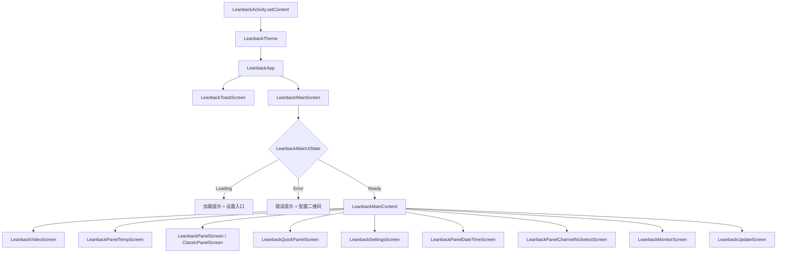

# 05 界面层

界面全部使用 Jetpack Compose + AndroidX TV Material 3，根节点为 [LeanbackApp](../app/src/main/java/top/yogiczy/mytv/ui/LeanbackApp.kt)。层级组织如下：



## 1. 根容器与全局行为

### 1.1 LeanbackApp

[LeanbackApp](../app/src/main/java/top/yogiczy/mytv/ui/LeanbackApp.kt) 负责：

- 挂载全局 Toast：`LeanbackToastScreen()`；
- 双击返回退出：`LeanbackDoubleBackPressedExitState` 使用 `Channel` + `debounce(2s)` 实现，首次返回提示“再按一次退出”；
- 提供全局内边距：`LeanbackParentPadding = PaddingValues(vertical = 12.dp, horizontal = 24.dp)`；
- `rememberLeanbackChildPadding()` 在父内边距基础上再增加 8dp 水平内边距，供面板子元素使用。

### 1.2 可见性控制

所有浮层通过 [LeanbackVisible](../app/src/main/java/top/yogiczy/mytv/ui/screens/leanback/components/Visible.kt)（内部为 `AnimatedVisibility`）按状态显示，避免重建播放器。

## 2. 主界面：LeanbackMainScreen

[LeanbackMainScreen](../app/src/main/java/top/yogiczy/mytv/ui/screens/leanback/main/MainScreen.kt) 订阅 `LeanbackMainViewModel.uiState`：

| 状态 | UI |
| --- | --- |
| `Loading` | 左下角“加载中...”，可显示重试进度（如“获取远程直播源(2/10)...”）；按菜单键可打开设置 |
| `Error` | 左下角“加载失败 + 原因”，右下角 100dp 二维码指向配置网页 |
| `Ready` | 渲染 `LeanbackMainContent` |

`LeanbackMainSettingsHandle` 在 Loading/Error 阶段包裹一个可获得焦点的 Box，菜单键直接打开设置页，便于用户修正错误的直播源地址。

## 3. 主内容与浮层优先级

[LeanbackMainContent](../app/src/main/java/top/yogiczy/mytv/ui/screens/leanback/main/components/MainContent.kt) 是界面编排核心，组合了：

| 组件 | 可见条件 |
| --- | --- |
| `LeanbackVideoScreen` | 始终存在（底层播放画面） |
| `LeanbackPanelTempScreen` | `isTempPanelVisible` 且其他面板/设置/快捷面板均不可见、数字输入为空 |
| `LeanbackPanelScreen` / `LeanbackClassicPanelScreen` | `isPanelVisible`，按 `uiUseClassicPanelScreen` 二选一 |
| `LeanbackQuickPanelScreen` | `isQuickPanelVisible && !isSettingsVisible` |
| `LeanbackSettingsScreen` | `isSettingsVisible` |
| `LeanbackPanelDateTimeScreen` | 所有浮层关闭且无数字输入 |
| `LeanbackPanelChannelNoSelectScreen` | 数字选台输入中 |
| `LeanbackMonitorScreen` | `debugShowFps` |
| `LeanbackUpdateScreen` | 有可用更新且用户确认时（内部自管理） |

补充机制：

- 通过 `CompositionLocalProvider(LocalDensity)` 应用 **界面缩放比例** 与 **字体缩放比例**（设置项 `uiDensityScaleRatio`、`uiFontScaleRatio`）；
- 使用 `LaunchedEffect` 每 100ms 请求一次焦点，解决浮层关闭后焦点丢失（源码有 `TODO` 说明这是临时方案）；
- 返回键处理顺序：选台面板 → 设置 → 快捷面板 → 交给 `LeanbackApp` 双击退出。

## 4. 遥控器与触摸输入

### 4.1 按键映射

[ModifierUtils](../app/src/main/java/top/yogiczy/mytv/ui/utils/ModifierUtils.kt) 提供 `Modifier.handleLeanbackKeyEvents(...)`，主界面映射：

| 按键 | 行为 |
| --- | --- |
| 上 / `CHANNEL_UP` | 上一个频道（受“换台反转”影响） |
| 下 / `CHANNEL_DOWN` | 下一个频道（受“换台反转”影响） |
| 左 | 上一条线路（`urlList.size > 1` 时） |
| 右 | 下一条线路（`urlList.size > 1` 时） |
| 确定 / 回车 / 小键盘回车 | 打开选台面板 |
| 长按确定 | 打开快捷面板 |
| 菜单 / 设置 / 帮助 / `H` | 打开快捷面板 |
| `L` | 等价长按确定 |
| 数字 0~9 | 数字选台（受 `iptvChannelNoSelectEnable` 控制） |
| 长按下方向键 | 打开快捷面板 |
| 返回 | 关闭浮层；无浮层时双击退出应用 |

长按判定基于 `KeyEvent.repeatCount == 1`（系统首次重复即触发），并非固定时长阈值。

### 4.2 触摸手势

`Modifier.handleLeanbackDragGestures(...)`：

- 速度阈值 `100.dp/s`，位移阈值 `10.dp`；
- 上滑/下滑换台，左滑/右滑切线路（与方向键逻辑一致）；
- 单击确定、长按打开快捷面板、双击打开设置。

### 4.3 数字选台

`LeanbackPanelChannelNoSelectState`（位于 [PanelChannelNoSelectScreen.kt](../app/src/main/java/top/yogiczy/mytv/ui/screens/leanback/panel/PanelChannelNoSelectScreen.kt)）：

- 每次输入追加一位数字；
- `debounce((4 - length) * 1000ms)`：输入 1 位等 3 秒、2 位等 2 秒、3 位等 1 秒、4 位立即确认；
- 确认后频道号减 1 作为扁平列表下标，越界忽略；
- 输入期间右上角显示数字，确认后清空。

## 5. 选台面板

项目提供两套选台界面，由 `SP.uiUseClassicPanelScreen` 切换。

### 5.1 新版面板：LeanbackPanelScreen

[LeanbackPanelScreen](../app/src/main/java/top/yogiczy/mytv/ui/screens/leanback/panel/PanelScreen.kt) 采用“视频画面 + 底部横向频道列表”结构：

| 区域 | 内容 |
| --- | --- |
| 右上角 | 频道号（两位补零）+ 竖线 + 时间（`LeanbackPanelDateTime`） |
| 左下 | 当前频道信息（名称、线路序号、当前/下一节目） |
| 左下（信息下方） | 播放器信息（分辨率、编码、解码器等） |
| 底部 | `TvLazyColumn` 分组列表，每组标题 + `TvLazyRow` 频道列表，高度固定 150dp |
| 收藏列表 | 在第一个分组的最上面按“上”键进入；无收藏时 Toast 提示 |
| 节目单弹窗 | 频道项上长按/特定操作打开 `LeanbackPanelIptvEpgDialog`，左右切换频道 |

交互：

- 点击空白区域关闭；
- 任意操作重置自动关闭计时（`PanelAutoCloseState`，默认 15s）；
- 收藏切换：`onIptvFavoriteToggle` → 写入 `SP.iptvChannelFavoriteList` 并 Toast 提示；
- 频道选中后立即 `changeCurrentIptv`。

### 5.2 经典面板：LeanbackClassicPanelScreen

[LeanbackClassicPanelScreen](../app/src/main/java/top/yogiczy/mytv/ui/screens/leanback/classicpanel/ClassicPanelScreen.kt) 为三段式布局：

| 列 | 内容 |
| --- | --- |
| 第 1 列 | 分组列表（收藏启用时首项为伪分组“我的收藏”） |
| 第 2 列 | 当前分组的频道列表 |
| 第 3 列 | 节目单（默认隐藏，按右键或点击“向右查看节目单”展开） |

特点：

- 焦点在分组列与频道列之间移动，右侧节目单通过 `focusProperties.exit` 拦截左键收起；
- 收藏分组由 `LeanbackClassicPanelScreenFavoriteIptvGroup` 构造，频道来源于 `SP.iptvChannelFavoriteList`；
- 面板四周使用 `LeanbackParentPadding + 8dp` 内边距并裁剪圆角。

### 5.3 临时频道信息与时间

| 组件 | 说明 |
| --- | --- |
| [LeanbackPanelTempScreen](../app/src/main/java/top/yogiczy/mytv/ui/screens/leanback/panel/PanelTempScreen.kt) | 换台后短暂显示：右上角频道号 + 左下频道信息；可选底部 3dp 节目进度条；1.5s 后由 `MainContentState` 隐藏 |
| [LeanbackPanelDateTimeScreen](../app/src/main/java/top/yogiczy/mytv/ui/screens/leanback/panel/PanelDateTimeScreen.kt) | 按 `uiTimeShowMode` 显示时间：`HIDDEN`、`ALWAYS`、`EVERY_HOUR`（整点前后 30s）、`HALF_HOUR`（半点前后 30s） |

### 5.4 自动关闭状态

[PanelAutoCloseState](../app/src/main/java/top/yogiczy/mytv/ui/screens/leanback/panel/PanelAutoCloseState.kt)：

```kotlin
channel.consumeAsFlow().debounce { timeout }.collect { onTimeout() }
```

- 使用 `Channel.CONFLATED` 保证只保留最后一次操作；
- 任何按键/滚动/点击都调用 `active()` 重置计时；
- 超时后调用 `onClose` 关闭面板。

## 6. 快捷面板：LeanbackQuickPanelScreen

[LeanbackQuickPanelScreen](../app/src/main/java/top/yogiczy/mytv/ui/screens/leanback/quickpanel/QuickPanelScreen.kt) 从底部弹出，包含：

| 按钮 | 行为 |
| --- | --- |
| 多线路 | 仅当 `urlList.size > 1` 时显示，打开线路选择对话框 |
| 清除缓存 | 清空 `SP.iptvPlayableHostList` + `cacheDir.deleteRecursively()`，Toast 提示“缓存已清除，请重启应用” |
| 画面比例 | 16:9 → 4:3 → 自动拉伸（屏幕比例）→ 16:9 循环 |
| 更多设置 | 打开完整设置页 |

顶部同样显示频道号、时间，左下显示频道与播放器信息，15s 无操作自动关闭。

## 7. 设置界面

[LeanbackSettingsScreen](../app/src/main/java/top/yogiczy/mytv/ui/screens/leanback/settings/SettingsScreen.kt) 为“左侧分类 + 右侧内容”结构，分类定义于 [SettingsCategories](../app/src/main/java/top/yogiczy/mytv/ui/screens/leanback/settings/SettingsCategories.kt)：

| 分类 | 关键设置项 |
| --- | --- |
| 关于 | 应用名称、版本、代码仓库（二维码/链接） |
| 应用 | 开机自启、显示模式（TV/手机/平板，当前点击提示“暂未开放”）、应用更新检查 |
| 直播源 | 数字选台、换台反转、直播源精简、缓存时间（短按 +1h，长按归零）、自定义直播源、源历史、清除缓存 |
| 节目单 | 启用节目单、刷新时间阈值、自定义节目单、历史、清除缓存 |
| 界面 | 节目进度、经典选台界面、时间显示模式、画中画、超时自动关闭、界面缩放、字体缩放 |
| 收藏 | 收藏启用、已收藏数量、清空收藏 |
| 更新 | 更新强提醒 |
| 播放器 | 全局画面比例、加载超时、自定义 UA |
| 网络 | 重试次数、重试间隔（只读展示） |
| 调试 | 显示 FPS、显示播放器信息 |
| 日志 | 最近 50 条日志（级别、标签、消息） |
| 更多设置 | 网页设置入口：展示 `HttpServer.serverUrl` 二维码 |

所有可编辑设置项通过 [LeanbackSettingsViewModel](../app/src/main/java/top/yogiczy/mytv/ui/screens/leanback/settings/SettingsViewModel.kt) 读写，写入即持久化到 `SP`；网络分类中的重试次数/间隔直接读取 `Constants`，为只读展示（带锁图标）。

列表项封装：

- [LeanbackSettingsCategoryListItem](../app/src/main/java/top/yogiczy/mytv/ui/screens/leanback/settings/components/SettingsCategoryListItem.kt)：支持副标题、尾部内容、锁图标（只读）、外链图标（二维码）；
- [LeanbackSettingsCategoryList](../app/src/main/java/top/yogiczy/mytv/ui/screens/leanback/settings/components/SettingsCategoryList.kt)：分类列表容器；
- [LeanbackSettingsCategoryContent](../app/src/main/java/top/yogiczy/mytv/ui/screens/leanback/settings/components/SettingsCategoryContent.kt)：按分类分发到具体内容组件。

## 8. 辅助界面

### 8.1 Toast

[LeanbackToastState](../app/src/main/java/top/yogiczy/mytv/ui/screens/leanback/toast/ToastState.kt)：

- 伴生对象 `I` 提供全局调用 `LeanbackToastState.I.showToast("...")`；
- 默认展示 2300ms，可传入自定义时长；
- [LeanbackToastScreen](../app/src/main/java/top/yogiczy/mytv/ui/screens/leanback/toast/ToastScreen.kt) 在根布局渲染，底部居中显示。

### 8.2 更新界面

[LeanbackUpdateScreen](../app/src/main/java/top/yogiczy/mytv/ui/screens/leanback/update/UpdateScreen.kt)：

- 首次组合后 3 秒检查更新；
- 有新版时：若开启“更新强提醒”则弹对话框，否则 Toast 提示；
- 确认后下载 APK 到缓存并调用安装器；下载期间展示进度与二维码（可扫码在手机下载）；
- 版本比较使用 `String.compareVersion`。

### 8.3 FPS 监控

[LeanbackMonitorScreen](../app/src/main/java/top/yogiczy/mytv/ui/screens/leanback/monitor/MonitorScreen.kt)：开启 `debugShowFps` 后左上角显示实时 FPS 与柱状图，用于低端设备性能排查。

### 8.4 通用组件

| 组件 | 作用 |
| --- | --- |
| `LeanbackVisible` | 带动画的可见性容器 |
| `LeanbackPadding` / `rememberLeanbackChildPadding` | 统一内边距 |
| `LeanbackQrcodeDialog` | 二维码对话框（设置页、错误页） |

## 9. 主题

[LeanbackTheme](../app/src/main/java/top/yogiczy/mytv/ui/theme/LeanbackTheme.kt)：

- 同时配置 Material3 `MaterialTheme` 与 TV Material3 `androidx.tv.material3.MaterialTheme`；
- 使用深色 `darkColorScheme`；
- 在主题内设置 `Surface` 为深色背景，适配电视全屏播放场景；
- 另有 `MobileTheme`、`PadTheme` 文件，但对应 Activity 为占位实现。

## 10. 已知交互细节与注意事项

1. **长按判定较早**：`repeatCount == 1` 即触发长按，部分遥控器可能感觉过于灵敏。
2. **系统导航键映射未生效**：`handleLeanbackKeyEvents` 中 `apply { KEYCODE_SYSTEM_NAVIGATION_* to ... }` 只是创建 Pair，并未写入 Map，实际未注册这些键。
3. **焦点轮询**：每 100ms 请求焦点属于权宜实现，未来可改为显式 `FocusRequester` 管理。
4. **经典面板节目单**：右侧节目单默认隐藏，必须向右操作展开，首次使用可能不易发现。
5. **新面板分组滚动**：底部是纵向分组 + 横向频道列表，遥控器上下键先在当前分组内移动，焦点行为依赖 TV Foundation 的默认策略。

下一篇：[06 配置与网络服务](06-配置与网络服务.md)
