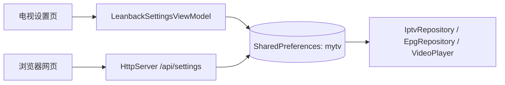

# 06 配置与网络服务

本项目的配置集中在 `SharedPreferences`（文件 `mytv`），并同时提供两种修改入口：

1. **电视端设置页**（Compose）：[LeanbackSettingsScreen](../app/src/main/java/top/yogiczy/mytv/ui/screens/leanback/settings/SettingsScreen.kt)；
2. **浏览器网页**（内置 HTTP 服务）：[HttpServer](../app/src/main/java/top/yogiczy/mytv/ui/utils/HttpServer.kt)，地址 `http://<设备IP>:10481`。



## 1. SharedPreferences 封装：SP

[SP](../app/src/main/java/top/yogiczy/mytv/ui/utils/SP.kt) 是全局单例（Kotlin `object`）：

```kotlin
object SP {
    private const val SP_NAME = "mytv"
    private lateinit var sp: SharedPreferences

    fun init(context: Context)   // 在 MyTVApplication.onCreate 中调用
}
```

- 键名统一使用内部枚举 `SP.KEY` 的 `name`；
- 所有属性均为 `var`，写入使用 `apply()` 异步落盘；
- 枚举存储为 `Int`，读取时通过 `fromValue` 兜底默认值。

### 1.1 配置项全集

#### 应用

| 属性 | KEY | 类型 | 默认值 | 说明 |
| --- | --- | --- | --- | --- |
| `appBootLaunch` | `APP_BOOT_LAUNCH` | Boolean | `false` | 开机自启，配合 `BootReceiver` |
| `appLastLatestVersion` | `APP_LAST_LATEST_VERSION` | String | `""` | 上次检测到的最新版本 |
| `appDeviceDisplayType` | `APP_DEVICE_DISPLAY_TYPE` | Enum Int | `LEANBACK(0)` | `LEANBACK / MOBILE / PAD` |

#### 调试

| 属性 | KEY | 类型 | 默认值 | 说明 |
| --- | --- | --- | --- | --- |
| `debugShowFps` | `DEBUG_SHOW_FPS` | Boolean | `false` | 左上角 FPS 浮层 |
| `debugShowVideoPlayerMetadata` | `DEBUG_SHOW_VIDEO_PLAYER_METADATA` | Boolean | `false` | 播放器编码/解码器信息 |

#### 直播源

| 属性 | KEY | 类型 | 默认值 | 说明 |
| --- | --- | --- | --- | --- |
| `iptvLastIptvIdx` | `IPTV_LAST_IPTV_IDX` | Int | `0` | 上次频道全局下标 |
| `iptvChannelChangeFlip` | `IPTV_CHANNEL_CHANGE_FLIP` | Boolean | `false` | 换台方向反转 |
| `iptvSourceSimplify` | `IPTV_SOURCE_SIMPLIFY` | Boolean | `false` | 仅保留央视/卫视 |
| `iptvSourceUrl` | `IPTV_SOURCE_URL` | String | 空串 | 直播源地址；未配置时界面提示自行添加 |
| `iptvSourceCacheTime` | `IPTV_SOURCE_CACHE_TIME` | Long | 24h | 直播源缓存时长（毫秒） |
| `iptvPlayableHostList` | `IPTV_PLAYABLE_HOST_LIST` | StringSet | 空 | 可播放的 URL host 记忆 |
| `iptvSourceUrlHistoryList` | `IPTV_SOURCE_URL_HISTORY_LIST` | StringSet | 空 | 成功使用过的源地址 |
| `iptvChannelNoSelectEnable` | `IPTV_CHANNEL_NO_SELECT_ENABLE` | Boolean | `true` | 数字选台 |
| `iptvChannelFavoriteEnable` | `IPTV_CHANNEL_FAVORITE_ENABLE` | Boolean | `true` | 频道收藏 |
| `iptvChannelFavoriteListVisible` | `IPTV_CHANNEL_FAVORITE_LIST_VISIBLE` | Boolean | `false` | 面板是否停留在收藏列表 |
| `iptvChannelFavoriteList` | `IPTV_CHANNEL_FAVORITE_LIST` | StringSet | 空 | 收藏的 `channelName` 集合 |

#### 节目单

| 属性 | KEY | 类型 | 默认值 | 说明 |
| --- | --- | --- | --- | --- |
| `epgEnable` | `EPG_ENABLE` | Boolean | `true` | 是否启用节目单 |
| `epgXmlUrl` | `EPG_XML_URL` | String | `Constants.EPG_XML_URL` | 节目单地址；空串回退默认 |
| `epgRefreshTimeThreshold` | `EPG_REFRESH_TIME_THRESHOLD` | Int | `2` | 凌晨几点前不刷新 |
| `epgXmlUrlHistoryList` | `EPG_XML_URL_HISTORY_LIST` | StringSet | 空 | 成功使用过的节目单地址 |

#### 界面

| 属性 | KEY | 类型 | 默认值 | 说明 |
| --- | --- | --- | --- | --- |
| `uiShowEpgProgrammeProgress` | `UI_SHOW_EPG_PROGRAMME_PROGRESS` | Boolean | `true` | 频道项显示节目进度条 |
| `uiUseClassicPanelScreen` | `UI_USE_CLASSIC_PANEL_SCREEN` | Boolean | `false` | 使用经典三段式选台 |
| `uiDensityScaleRatio` | `UI_DENSITY_SCALE_RATIO` | Float | `1f` | 界面整体缩放 |
| `uiFontScaleRatio` | `UI_FONT_SCALE_RATIO` | Float | `1f` | 字体缩放 |
| `uiTimeShowMode` | `UI_TIME_SHOW_MODE` | Enum Int | `HIDDEN(0)` | `HIDDEN / ALWAYS / EVERY_HOUR / HALF_HOUR` |
| `uiPipMode` | `UI_PIP_MODE` | Boolean | `false` | 画中画 |

#### 更新与播放器

| 属性 | KEY | 类型 | 默认值 | 说明 |
| --- | --- | --- | --- | --- |
| `updateForceRemind` | `UPDATE_FORCE_REMIND` | Boolean | `false` | 发现新版本时弹窗而非 Toast |
| `videoPlayerUserAgent` | `VIDEO_PLAYER_USER_AGENT` | String | `ExoPlayer` | 播放请求 UA |
| `videoPlayerLoadTimeout` | `VIDEO_PLAYER_LOAD_TIMEOUT` | Long | `15000` | 加载超时/卡顿检测 |
| `videoPlayerAspectRatio` | `VIDEO_PLAYER_ASPECT_RATIO` | Enum Int | `ORIGINAL(0)` | 全局画面比例 |

### 1.2 使用示例

```kotlin
// 读取
val sourceUrl = SP.iptvSourceUrl
val favorites = SP.iptvChannelFavoriteList

// 写入
SP.iptvLastIptvIdx = index
SP.iptvChannelFavoriteList = favorites + channelName
SP.uiShowEpgProgrammeProgress = !SP.uiShowEpgProgrammeProgress
```

> 收藏与历史使用 `StringSet`，注意 `SharedPreferences` 返回的 Set 不应直接修改，需先复制或通过 `+/-` 生成新集合（项目均采用后者）。

## 2. 内置 HTTP 服务：HttpServer

### 2.1 启动与地址

- 监听端口：**10481**；
- 在 [LeanbackActivity](../app/src/main/java/top/yogiczy/mytv/activities/LeanbackActivity.kt) 中启动：`HttpServer.start(this) { message -> Toast... }`；
- `serverUrl` 惰性计算：遍历网卡取第一个非回环 **IPv4** 地址，失败回退 `0.0.0.0`；
- 启动成功日志：`服务已启动: 0.0.0.0:10481`；失败 Toast“设置服务启动失败”。

### 2.2 路由一览

| 方法 | 路径 | 功能 | 响应 |
| --- | --- | --- | --- |
| GET | `/` | 配置网页 HTML（`R.raw.index`） | `text/html` |
| GET | `/index_css.css` | 网页样式（`R.raw.index_css`） | `text/css` |
| GET | `/index_js.js` | 网页脚本（`R.raw.index_js`） | `text/javascript` |
| GET | `/api/settings` | 读取当前配置与日志 | `application/json` |
| POST | `/api/settings` | 保存配置 | 纯文本 `success` |
| POST | `/api/upload/apk` | 上传新版本 APK 并触发安装 | 纯文本 `success` |

所有响应都通过 `wrapResponse` 添加 CORS 头（`Access-Control-Allow-Origin: *` 等）。

### 2.3 GET /api/settings 响应结构

```json
{
  "appTitle": "我的电视",
  "appRepo": "https://github.com/yaoxieyoulei/mytv-android",
  "iptvSourceUrl": "",
  "epgXmlUrl": "http://example.com/e.xml.gz",
  "videoPlayerUserAgent": "ExoPlayer",
  "logHistory": [
    {
      "level": "INFO",
      "tag": "HttpServer",
      "message": "服务已启动: 0.0.0.0:10481",
      "cause": null,
      "time": 1730000000000
    }
  ]
}
```

字段由 `@Serializable data class AllSettings` 定义，日志最多 50 条（`Constants.LOG_HISTORY_MAX_SIZE`）。

### 2.4 POST /api/settings 请求体

```json
{
  "iptvSourceUrl": "http://example.com/live.m3u",
  "epgXmlUrl": "http://example.com/e.xml.gz",
  "videoPlayerUserAgent": "MyTV/1.4.5"
}
```

处理逻辑：

| 字段 | 变化时行为 |
| --- | --- |
| `iptvSourceUrl` | 写入 SP 并 `IptvRepository().clearCache()` |
| `epgXmlUrl` | 写入 SP 并 `EpgRepository().clearCache()` |
| `videoPlayerUserAgent` | 仅写入 SP |

> 修改配置后需要**重启应用**才能重新加载直播源（缓存已清空，重启时会重新拉取）。

### 2.5 POST /api/upload/apk

- 使用 `multipart/form-data`；
- 文件流写入 `cacheDir/uploaded_apk.apk`；
- 接收过程中通过 Toast 实时显示百分比；
- 接收完成调用 `ApkInstaller.installApk` 拉起系统安装器（Android 8+ 需用户授予“安装未知应用”权限）。

### 2.6 网页配置页

网页静态资源位于：

| 文件 | 说明 |
| --- | --- |
| [index.html](../app/src/main/res/raw/index.html) | 页面结构、样式与交互脚本（自包含，不依赖外部 CDN） |
| [index_css.css](../app/src/main/res/raw/index_css.css) | 本地静态资源，供旧版 `/index_css.css` 路由使用 |
| [index_js.js](../app/src/main/res/raw/index_js.js) | 本地静态资源（Vue/Vant 运行时），供旧版 `/index_js.js` 路由使用 |

网页端能力与电视端设置项存在差异：网页主要覆盖 **源地址、EPG 地址、UA、日志查看、APK 上传**，其余配置需在电视端修改。

> 自 1.4.5 起配置页改为自包含布局：响应式排版、明暗主题自适应、配置状态提示与保存校验，核心样式与脚本内联在 `index.html`，局域网离线也能正常使用。

## 3. 设置页状态：LeanbackSettingsViewModel

[LeanbackSettingsViewModel](../app/src/main/java/top/yogiczy/mytv/ui/screens/leanback/settings/SettingsViewModel.kt) 的作用是：

1. 将 `SP` 中的值复制为 Compose `mutableStateOf`，便于界面即时刷新；
2. 提供 `var` setter，写入时同步更新内存状态与 `SP`。

典型模式：

```kotlin
var iptvChannelChangeFlip by mutableStateOf(SP.iptvChannelChangeFlip)
    set(value) {
        field = value
        SP.iptvChannelChangeFlip = value
    }
```

设置页各分类组件只依赖 ViewModel，不直接访问 `SP`（少数只读展示除外）。

## 4. 更新机制

### 4.1 数据来源

- 最新版本 API：`Constants.GIT_RELEASE_LATEST_URL`（GitHub Releases latest）；
- GitHub 下载地址自动拼接镜像前缀 `Constants.GITHUB_PROXY`；
- 解析器依据 URL 域名选择 GitHub / Gitee 实现。

### 4.2 检查与提示

[LeanBackUpdateViewModel](../app/src/main/java/top/yogiczy/mytv/ui/screens/leanback/update/UpdateViewModel.kt)：

```kotlin
suspend fun checkUpdate(currentVersion: String) {
    _latestRelease = GitRepository().latestRelease(Constants.GIT_RELEASE_LATEST_URL)
    _isUpdateAvailable = _latestRelease.version.compareVersion(currentVersion) > 0
}
```

- 防重入：检查阶段使用 `_isChecking`，下载阶段使用 `_isUpdating`，且已有可用更新时不再重复检查；
- 失败只记录日志，不打断播放；
- 更新界面在启动 3 秒后自动检查一次；
- 仅当新版本号不同于 `SP.appLastLatestVersion` 时才提醒，避免每次启动重复提示；
- `updateForceRemind = true` 时弹窗，否则 Toast。

### 4.3 下载与安装

```kotlin
suspend fun downloadAndUpdate(latestFile: File) {
    Downloader.downloadTo(latestRelease.downloadUrl, latestFile.path) { progress ->
        LeanbackToastState.I.showToast("正在下载更新: $progress%", ...)
    }
    _updateDownloaded = true
}
```

- 下载目标为 `cacheDir/latest.apk`；
- 进度通过自定义 `ResponseBody` 的 `ForwardingSource` 计算；
- 下载完成由界面调用 `ApkInstaller.installApk`；
- `ApkInstaller` 会复制文件到 `cacheDir`、设置 `setReadable(true, false)`（兼容 Android 6），再通过 `FileProvider` 打开安装意图。

## 5. 日志

[Logger](../app/src/main/java/top/yogiczy/mytv/utils/Logger.kt)：

| 级别 | 是否进入历史 |
| --- | --- |
| `d` | 否（代码已注释） |
| `i` / `w` / `e` / `wtf` | 是 |

- 历史保存在内存 `Logger.history`，最多 50 条，超出移除最旧；
- `Loggable` 抽象类为仓库/工具类注入按类名命名的 Logger；
- 设置页“日志”分类与网页 `/api/settings` 都能查看历史。

## 6. 配置变更影响面

| 配置 | 生效时机 | 影响 |
| --- | --- | --- |
| 直播源地址 | 清缓存 + 重启 | 重新拉取解析频道列表 |
| 节目单地址 | 清缓存 + 重启 | 重新拉取 EPG |
| 直播源精简 | 重启 | 频道数量变化 |
| 换台反转 | 立即 | 上/下滑动与方向键方向 |
| 数字选台 | 立即 | 数字键是否响应 |
| 经典选台界面 | 立即 | 面板实现切换 |
| 画面比例 | 立即 | `VideoPlayerState.aspectRatio` 默认值/快捷面板 |
| 加载超时 | 立即（新播放生效） | 超时换源、断流重连 |
| 界面/字体缩放 | 立即 | `CompositionLocalProvider(LocalDensity)` |
| UA | 下次 prepare 生效 | 播放请求头 |

下一篇：[07 构建与运行](07-构建与运行.md)
