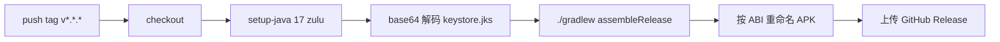

# 07 构建与运行

## 1. 环境要求

| 项 | 要求 |
| --- | --- |
| JDK | **17**（GitHub Actions 使用 zulu 17；用于运行 Gradle，源码字节码目标仍为 1.8） |
| Gradle | Wrapper 已固定为 **8.7**，无需手动安装 |
| Android Gradle Plugin | **8.5.0** |
| Android SDK | **compileSdk 34**（Android 14） |
| Build Tools | 由 AGP 自动选择（建议安装 34.0.0） |
| 设备/模拟器 | Android 5.0（API 21）及以上，推荐 Android TV |
| 网络 | 需可访问自行配置的直播源；使用 IPv6 源时需 IPv6 网络环境 |

## 2. 获取与配置

```bash
git clone https://github.com/yaoxieyoulei/mytv-android.git
cd mytv-android
```

### 2.1 指定 SDK 路径

在项目根目录创建 `local.properties`：

```properties
sdk.dir=/path/to/Android/Sdk
```

> `local.properties` 不应提交到版本库。

### 2.2 直接使用 Android Studio

1. 使用 Android Studio（建议 Ladybug 及以上）打开项目；
2. 等待 Gradle Sync 完成；
3. 选择 `app` 运行配置，连接 TV/模拟器运行。

## 3. 命令行构建

```bash
# Debug 包（无需签名配置）
./gradlew assembleDebug

# Release 包（需要签名配置，见下一节）
./gradlew assembleRelease

# 清理
./gradlew clean
```

产物位置：

| 类型 | 路径 |
| --- | --- |
| Debug | `app/build/outputs/apk/debug/app-debug.apk` |
| Release | `app/build/outputs/apk/release/app-release.apk` |

> 项目未配置 ABI splits，`abiFilters` 只决定单个 APK 内打包哪些架构，因此 Release 默认输出一个通用 APK；CI 的重命名脚本虽按 `app-<abi>-release.apk` 模式匹配，但当前会得到 `mytv-android-<版本>.apk`。

Release 开启 `isMinifyEnabled = true` 与 `isShrinkResources = true`，规则文件为 `app/proguard-rules.pro`。

### 3.1 ABI 支持

```kotlin
ndk {
    abiFilters.addAll(listOf("armeabi-v7a", "arm64-v8a", "x86_64"))
}
```

不包含 `x86`，X86 32 位模拟器无法运行。

### 3.2 FFmpeg 解码扩展

`app/libs/lib-decoder-ffmpeg-release.aar` 通过 `fileTree` 引入，用于软解部分编码。若删除该文件，编译会失败或播放器缺少扩展渲染器。

## 4. 签名配置

`app/build.gradle.kts` 支持两种方式提供签名信息，**环境变量优先**：

### 4.1 key.properties（本地）

在**项目根目录**创建 `key.properties`：

```properties
storeFile=keystore.jks
storePassword=your_store_password
keyAlias=your_key_alias
keyPassword=your_key_password
```

`storeFile` 相对 `app` 模块目录解析；也可使用绝对路径。

### 4.2 环境变量（CI）

| 变量 | 含义 |
| --- | --- |
| `KEYSTORE` | keystore 文件路径 |
| `KEYSTORE_PASSWORD` | store 密码 |
| `KEY_ALIAS` | 密钥别名 |
| `KEY_PASSWORD` | 密钥密码 |

> 没有签名文件时，`assembleRelease` 会因找不到 `keystore.jks` 失败；日常开发使用 `assembleDebug` 即可。

## 5. CI 自动发布

[release.yml](../.github/workflows/release.yml) 在推送形如 `v1.2.3` 的 Tag 时触发：



关键步骤：

```yaml
- run: echo $KEYSTORE_BASE64 | base64 -di > app/keystore.jks
- run: chmod +x ./gradlew && ./gradlew assembleRelease
  env:
    KEYSTORE_PASSWORD: ${{ secrets.KEYSTORE_PASSWORD }}
    KEY_ALIAS: ${{ secrets.KEY_ALIAS }}
    KEY_PASSWORD: ${{ secrets.KEY_PASSWORD }}
```

发布动作使用 `ncipollo/release-action@v1`，Tag 名去掉前缀 `v` 作为版本号；重命名脚本将 `app-*.apk` 改为 `mytv-android-<abi><version>.apk`（无 ABI splits 时即为 `mytv-android-<version>.apk`）。

## 6. 安装与首次运行

### 6.1 安装

```bash
adb install -r app/build/outputs/apk/debug/app-debug.apk
```

电视端也可通过 U 盘安装（需允许“未知来源应用”）。

### 6.2 首次启动必做配置

**应用不内置直播源**，首次启动必须自行配置，否则主界面会提示“尚未配置直播源”。

两种方式：

1. **网页配置（推荐）**
   - 电视与手机/电脑在同一局域网；
   - 浏览器打开 `http://<电视IP>:10481`；
   - 填写订阅源地址，保存；
   - 重启应用。
2. **电视端设置**
   - 按菜单键 / 双击屏幕打开设置；
   - 进入“直播源 → 自定义直播源”，输入 M3U 或 TVBox 地址；
   - 重启应用。

### 6.3 常用操作

| 操作 | 遥控器 | 触摸 |
| --- | --- | --- |
| 换台 | 上/下、频道 +/-、数字键 | 上下滑动、数字输入 |
| 选台面板 | OK | 单击 |
| 快捷面板 | 长按 OK、菜单/帮助键 | 长按、双击 |
| 切线路 | 左/右 | 左右滑动 |
| 收藏/取消 | 选台面板中长按 OK | 长按频道 |
| 收藏列表 | 频道列表顶部再按上 | 长按频道信息 |
| 设置 | 菜单/帮助键 | 双击 |
| 退出 | 返回键按两次 | 返回手势两次 |

## 7. 网络与安全注意事项

1. **明文流量**：`usesCleartextTraffic="true"`，可播放 `http://` 源。
2. **忽略证书校验**：[UnsafeTrustManager](../app/src/main/java/top/yogiczy/mytv/UnsafeTrustManager.kt) 在 Application 启动时全局安装，所有 HTTPS 证书均被信任，存在中间人风险。
3. **权限**：仅申请 `INTERNET`、`RECEIVE_BOOT_COMPLETED`、`REQUEST_INSTALL_PACKAGES`，不申请存储权限；应用固定横屏（`sensorLandscape`）。
4. **IPv6**：应用不内置源；若所选直播源为 IPv6 地址，纯 IPv4 网络无法播放，需更换源或启用 IPv6。
5. **HTTP 服务无鉴权**：`10481` 端口暴露在局域网，任何同网设备都可读写配置、上传 APK 并触发安装。仅在可信网络使用。
6. **GitHub 加速代理**：更新下载默认拼接 `https://mirror.ghproxy.com/`，代理不可用时更新会失败。

## 8. 常见问题排查

| 现象 | 可能原因 | 处理 |
| --- | --- | --- |
| 启动后提示“尚未配置直播源” | 应用不内置直播源 | 通过网页或电视端设置配置订阅源后重启 |
| 启动一直“加载中” | 网络不通/源站慢 | 查看重试进度；检查 IPv6；更换源 |
| 频道列表为空 | 源格式不支持 | 仅支持 M3U / TVBox（`#genre#`），确认源内容 |
| 没有节目单 | EPG 未启用、凌晨 2 点前、频道名不匹配 | 检查“节目单”设置与 `tvg-name` |
| 播放黑屏/失败 | 编码不支持、源失效 | 查看错误码；切换线路；开启播放器信息排查 |
| 更新失败 | 代理不可用、无 assets | 手动下载 Release APK 安装 |
| 网页打不开 | 端口占用、不同网段、IP 取错 | 查看启动日志；确认同局域网；尝试设备实际 IP |
| Release 构建失败 | 缺少 keystore | 配置 `key.properties` 或环境变量 |
| 构建 OOM/慢 | Gradle 内存不足 | 在 `gradle.properties` 调整 `org.gradle.jvmargs` |
| 安装被拦截 | 未允许未知来源 | 系统设置中授予安装权限 |

## 9. 版本升级流程（维护者）

1. 修改 `app/build.gradle.kts` 中 `versionName`（以及必要时 `versionCode`）；
2. 更新 [CHANGELOG.md](../CHANGELOG.md)；
3. 提交并打 Tag：

```bash
git tag v1.4.5
git push origin v1.4.5
```

4. GitHub Actions 自动构建并发布 Release；
5. 应用内更新会拉取 `releases/latest` 并比较版本号。

## 10. 测试现状

仓库内置：

- `app/src/test/.../ExampleUnitTest.kt`：本地 JUnit 模板；
- `app/src/androidTest/.../ExampleInstrumentedTest.kt`：Instrumentation 模板。

没有覆盖业务逻辑的自动化测试，验证主要依赖手工运行。建议二次开发时为解析器（M3U/TVBox/EPG）补充单元测试，因为它们是纯函数式且易构造样本。

下一篇：[08 依赖与调用关系](08-依赖与调用关系.md)
