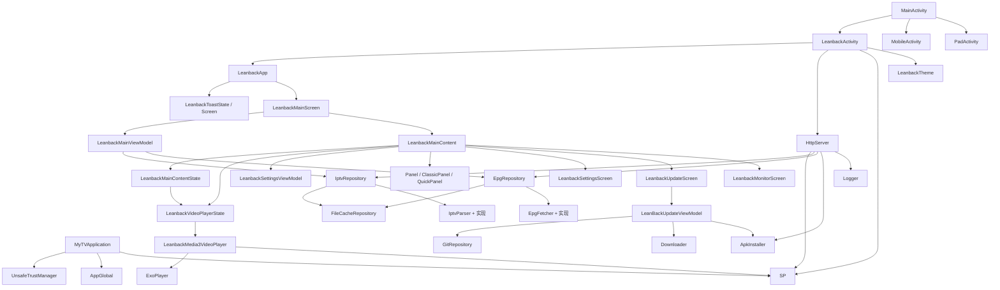
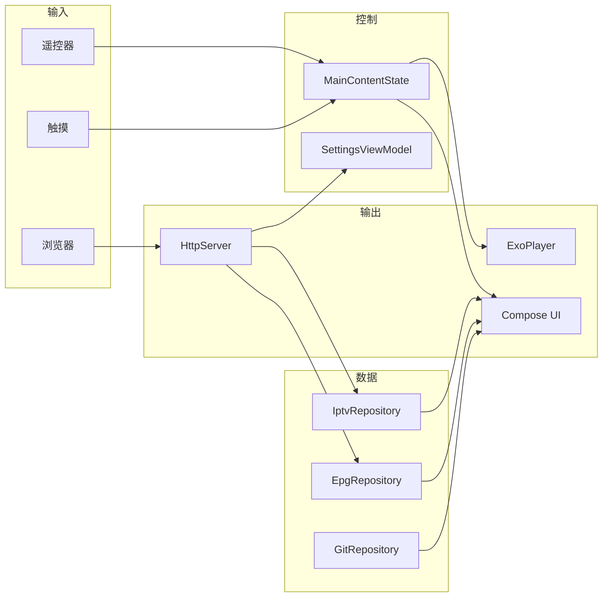

# 08 依赖与调用关系

## 1. 构建依赖

### 1.1 Gradle 插件

| 插件 | 版本 | 作用 |
| --- | --- | --- |
| `com.android.application` | 8.5.0 | Android 应用模块 |
| `org.jetbrains.kotlin.android` | 2.0.0 | Kotlin 编译 |
| `org.jetbrains.kotlin.plugin.compose` | 2.0.0 | Compose 编译器插件（Kotlin 2.0 起独立） |
| `org.jetbrains.kotlin.plugin.serialization` | 2.0.0 | `@Serializable` 代码生成 |

### 1.2 运行时依赖

| 依赖 | 版本 | 用途 |
| --- | --- | --- |
| `androidx.core:core-ktx` | 1.13.1 | Kotlin 扩展 |
| `androidx.lifecycle:lifecycle-runtime-ktx` | 2.8.2 | 生命周期 |
| `androidx.lifecycle:lifecycle-viewmodel-compose` | 2.8.2 | `viewModel()` |
| `androidx.activity:activity-compose` | 1.9.0 | `setContent` |
| `androidx.compose:compose-bom` | 2024.06.00 | Compose 版本对齐 |
| `androidx.compose.ui:ui` / `ui-graphics` | BOM | 基础 UI |
| `androidx.compose.material3:material3` | BOM | 常规 Material 3 |
| `androidx.compose.material:material-icons-extended` | BOM | 设置分类图标 |
| `androidx.tv:tv-foundation` | 1.0.0-alpha10 | `TvLazyRow/Column`、TV 手势 |
| `androidx.tv:tv-material` | 1.0.0-beta01 | TV 组件与主题 |
| `androidx.media3:media3-exoplayer` | 1.3.1 | 播放器核心 |
| `androidx.media3:media3-exoplayer-hls` | 1.3.1 | HLS |
| `androidx.media3:media3-exoplayer-rtsp` | 1.3.1 | RTSP |
| `org.jetbrains.kotlinx:kotlinx-serialization-json` | 1.7.0 | JSON 缓存与设置接口 |
| `org.jetbrains.kotlinx:kotlinx-collections-immutable` | 0.3.7 | 不可变集合 |
| `com.squareup.okhttp3:okhttp` | 4.12.0 | 数据拉取、下载 |
| `com.koushikdutta.async:androidasync` | 3.1.0 | 内置 HTTP 服务 |
| `io.github.alexzhirkevich:qrose` | 1.0.1 | 二维码 |
| `libs/*.aar` | 本地 | FFmpeg 解码扩展 |

### 1.3 测试依赖

JUnit 4.13.2、AndroidX JUnit 1.1.5、Espresso 3.5.1、Compose UI Test（BOM），仅包含模板测试。

## 2. 运行时模块依赖图



## 3. 关键调用链

### 3.1 启动加载

```
MyTVApplication.onCreate
 ├─ UnsafeTrustManager.enableUnsafeTrustManager()
 ├─ AppGlobal.cacheDir = cacheDir
 └─ SP.init(context)

LeanbackActivity.onCreate
 ├─ setContent { LeanbackTheme { LeanbackApp } }
 └─ HttpServer.start()

LeanbackMainScreen(viewModel -> LeanbackMainViewModel)
 ├─ init { refreshIptv(); refreshEpg() }
 │    ├─ IptvRepository.getIptvGroupList
 │    │    ├─ FileCacheRepository.getOrRefresh(24h)
 │    │    ├─ IptvRepository.fetchSource (OkHttp)
 │    │    └─ IptvParser.instances.first { isSupport }.parse()
 │    └─ EpgRepository.getEpgList
 │         ├─ epgRefreshTimeThreshold 判断
 │         ├─ EpgXmlRepository.getEpgXml
 │         │    ├─ fetchXml (OkHttp)
 │         │    └─ EpgFetcher.instances.first { isSupport }.fetch()
 │         ├─ parseFromXml (XmlPullParser)
 │         └─ 读写 epg.json
 └─ UiState.Ready → LeanbackMainContent
      ├─ rememberLeanbackVideoPlayerState
      ├─ rememberLeanbackMainContentState
      └─ changeCurrentIptv → VideoPlayerState.prepare → ExoPlayer
```

### 3.2 换台

```
KeyEvent / Swipe / Panel onIptvSelected
 └─ LeanbackMainContentState.changeCurrentIptv
      ├─ 关闭选台面板、显示临时面板
      ├─ SP.iptvLastIptvIdx = iptvGroupList.iptvIdx(iptv)
      ├─ 选择线路（可播放 host 优先）
      └─ LeanbackVideoPlayerState.prepare(url)
           └─ Media3VideoPlayer.prepare
                ├─ DefaultHttpDataSource(UA, timeout)
                ├─ HlsMediaSource / RtspMediaSource / ProgressiveMediaSource
                └─ ExoPlayer.prepare/play

回调：
onReady   → MainContentState 记录 host、1.5s 后隐藏临时面板
onError   → 自动切换下一条线路
onCutoff  → 重新 prepare 当前线路
```

### 3.3 设置保存

```
LeanbackSettingsCategoryXxx
 └─ LeanbackSettingsViewModel.<property> setter
      ├─ field = value（Compose 重组）
      └─ SP.<property> = value（持久化）

网页保存：
POST /api/settings
 └─ HttpServer.handleSetSettings
      ├─ SP.iptvSourceUrl + IptvRepository.clearCache()
      ├─ SP.epgXmlUrl + EpgRepository.clearCache()
      └─ SP.videoPlayerUserAgent
```

### 3.4 更新

```
LeanbackUpdateScreen (3s 后)
 └─ LeanBackUpdateViewModel.checkUpdate(BuildConfig.VERSION_NAME)
      └─ GitRepository.latestRelease(Constants.GIT_RELEASE_LATEST_URL)
           └─ GithubGitReleaseParser.parse (JSON → GitRelease)
      └─ compareVersion > 0 → isUpdateAvailable

用户确认
 └─ downloadAndUpdate(File(cacheDir, "latest.apk"))
      ├─ Downloader.downloadTo (OkHttp + 进度回调)
      └─ ApkInstaller.installApk (FileProvider + ACTION_VIEW)
```

### 3.5 网页上传 APK

```
浏览器 POST /api/upload/apk (multipart)
 └─ HttpServer.handleUploadApk
      ├─ 流式写入 cacheDir/uploaded_apk.apk
      ├─ Toast 显示接收进度
      └─ ApkInstaller.installApk
```

## 4. 源码文件索引

### 4.1 根包

| 文件 | 职责 |
| --- | --- |
| [AppGlobal.kt](../app/src/main/java/top/yogiczy/mytv/AppGlobal.kt) | 全局变量，当前仅缓存目录 |
| [MyTVApplication.kt](../app/src/main/java/top/yogiczy/mytv/MyTVApplication.kt) | Application 初始化 |
| [BootReceiver.kt](../app/src/main/java/top/yogiczy/mytv/BootReceiver.kt) | 开机广播启动 LeanbackActivity |
| [UnsafeTrustManager.kt](../app/src/main/java/top/yogiczy/mytv/UnsafeTrustManager.kt) | 全局信任所有 TLS 证书 |

### 4.2 activities

| 文件 | 职责 |
| --- | --- |
| [MainActivity.kt](../app/src/main/java/top/yogiczy/mytv/activities/MainActivity.kt) | 按显示类型分发到具体 Activity（Manifest 未设为 LAUNCHER） |
| [LeanbackActivity.kt](../app/src/main/java/top/yogiczy/mytv/activities/LeanbackActivity.kt) | TV 主入口，隐藏系统栏、常亮、PiP、启动 HTTP 服务 |
| [MobileActivity.kt](../app/src/main/java/top/yogiczy/mytv/activities/MobileActivity.kt) | 手机端占位 |
| [PadActivity.kt](../app/src/main/java/top/yogiczy/mytv/activities/PadActivity.kt) | 平板端占位 |

### 4.3 data/entities

| 文件 | 职责 |
| --- | --- |
| [Iptv.kt](../app/src/main/java/top/yogiczy/mytv/data/entities/Iptv.kt) | 频道模型 |
| [IptvList.kt](../app/src/main/java/top/yogiczy/mytv/data/entities/IptvList.kt) | 频道列表包装 |
| [IptvGroup.kt](../app/src/main/java/top/yogiczy/mytv/data/entities/IptvGroup.kt) | 频道分组 |
| [IptvGroupList.kt](../app/src/main/java/top/yogiczy/mytv/data/entities/IptvGroupList.kt) | 分组列表 + 下标查找扩展 |
| [Epg.kt](../app/src/main/java/top/yogiczy/mytv/data/entities/Epg.kt) | 单频道节目单 + 当前节目 |
| [EpgList.kt](../app/src/main/java/top/yogiczy/mytv/data/entities/EpgList.kt) | 节目单集合 + 按频道查询 |
| [EpgProgramme.kt](../app/src/main/java/top/yogiczy/mytv/data/entities/EpgProgramme.kt) | 节目条目 + 直播/进度判断 |
| [EpgProgrammeList.kt](../app/src/main/java/top/yogiczy/mytv/data/entities/EpgProgrammeList.kt) | 节目列表包装 |
| [EpgProgrammeCurrent.kt](../app/src/main/java/top/yogiczy/mytv/data/entities/EpgProgrammeCurrent.kt) | 当前/下一个节目 |
| [GitRelease.kt](../app/src/main/java/top/yogiczy/mytv/data/entities/GitRelease.kt) | 版本发布信息 |

### 4.4 data/repositories

| 文件 | 职责 |
| --- | --- |
| [FileCacheRepository.kt](../app/src/main/java/top/yogiczy/mytv/data/repositories/FileCacheRepository.kt) | 文件缓存模板 |
| [iptv/IptvRepository.kt](../app/src/main/java/top/yogiczy/mytv/data/repositories/iptv/IptvRepository.kt) | 直播源拉取、精简、解析调度 |
| [iptv/parser/IptvParser.kt](../app/src/main/java/top/yogiczy/mytv/data/repositories/iptv/parser/IptvParser.kt) | 解析器接口 + 注册表 |
| [iptv/parser/M3uIptvParser.kt](../app/src/main/java/top/yogiczy/mytv/data/repositories/iptv/parser/M3uIptvParser.kt) | M3U 解析 |
| [iptv/parser/TvboxIptvParser.kt](../app/src/main/java/top/yogiczy/mytv/data/repositories/iptv/parser/TvboxIptvParser.kt) | TVBox 解析 |
| [iptv/parser/DefaultIptvParser.kt](../app/src/main/java/top/yogiczy/mytv/data/repositories/iptv/parser/DefaultIptvParser.kt) | 未知格式兜底 |
| [epg/EpgRepository.kt](../app/src/main/java/top/yogiczy/mytv/data/repositories/epg/EpgRepository.kt) | EPG 获取、解析、按天缓存 |
| [epg/fetcher/EpgFetcher.kt](../app/src/main/java/top/yogiczy/mytv/data/repositories/epg/fetcher/EpgFetcher.kt) | 抓取器接口 + 注册表 |
| [epg/fetcher/XmlEpgFetcher.kt](../app/src/main/java/top/yogiczy/mytv/data/repositories/epg/fetcher/XmlEpgFetcher.kt) | 纯 XML |
| [epg/fetcher/XmlGzEpgFetcher.kt](../app/src/main/java/top/yogiczy/mytv/data/repositories/epg/fetcher/XmlGzEpgFetcher.kt) | GZIP XML |
| [epg/fetcher/DefaultEpgFetcher.kt](../app/src/main/java/top/yogiczy/mytv/data/repositories/epg/fetcher/DefaultEpgFetcher.kt) | 空 XML 兜底 |
| [git/GitRepository.kt](../app/src/main/java/top/yogiczy/mytv/data/repositories/git/GitRepository.kt) | Release API 拉取 |
| [git/parser/GitReleaseParser.kt](../app/src/main/java/top/yogiczy/mytv/data/repositories/git/parser/GitReleaseParser.kt) | 发布信息解析接口 |
| [git/parser/GithubGitReleaseParser.kt](../app/src/main/java/top/yogiczy/mytv/data/repositories/git/parser/GithubGitReleaseParser.kt) | GitHub + 加速代理 |
| [git/parser/GiteeGitReleaseParser.kt](../app/src/main/java/top/yogiczy/mytv/data/repositories/git/parser/GiteeGitReleaseParser.kt) | Gitee |
| [data/utils/Constants.kt](../app/src/main/java/top/yogiczy/mytv/data/utils/Constants.kt) | 全局常量 |

### 4.5 ui 根与通用

| 文件 | 职责 |
| --- | --- |
| [ui/LeanbackApp.kt](../app/src/main/java/top/yogiczy/mytv/ui/LeanbackApp.kt) | 根 Composable、双击退出、内边距 |
| [ui/theme/LeanbackTheme.kt](../app/src/main/java/top/yogiczy/mytv/ui/theme/LeanbackTheme.kt) | TV 深色主题 |
| [ui/theme/MobileTheme.kt](../app/src/main/java/top/yogiczy/mytv/ui/theme/MobileTheme.kt) | 手机主题（占位） |
| [ui/theme/PadTheme.kt](../app/src/main/java/top/yogiczy/mytv/ui/theme/PadTheme.kt) | 平板主题（占位） |
| [components/Visible.kt](../app/src/main/java/top/yogiczy/mytv/ui/screens/leanback/components/Visible.kt) | 可见性动画容器 |
| [components/Padding.kt](../app/src/main/java/top/yogiczy/mytv/ui/screens/leanback/components/Padding.kt) | LeanbackPadding 数据类 |
| [components/Qrcode.kt](../app/src/main/java/top/yogiczy/mytv/ui/screens/leanback/components/Qrcode.kt) | 二维码对话框 |

### 4.6 main

| 文件 | 职责 |
| --- | --- |
| [main/MainScreen.kt](../app/src/main/java/top/yogiczy/mytv/ui/screens/leanback/main/MainScreen.kt) | 加载/错误/就绪三态界面 |
| [main/MainViewModel.kt](../app/src/main/java/top/yogiczy/mytv/ui/screens/leanback/main/MainViewModel.kt) | 直播源与 EPG 加载、重试 |
| [main/components/MainContent.kt](../app/src/main/java/top/yogiczy/mytv/ui/screens/leanback/main/components/MainContent.kt) | 主内容编排、按键/手势映射 |
| [main/components/MainContentState.kt](../app/src/main/java/top/yogiczy/mytv/ui/screens/leanback/main/components/MainContentState.kt) | 频道/线路状态与切换算法 |

### 4.7 video

| 文件 | 职责 |
| --- | --- |
| [video/VideoScreen.kt](../app/src/main/java/top/yogiczy/mytv/ui/screens/leanback/video/VideoScreen.kt) | SurfaceView 渲染、错误/元数据叠加 |
| [video/VideoPlayerState.kt](../app/src/main/java/top/yogiczy/mytv/ui/screens/leanback/video/VideoPlayerState.kt) | 播放状态与生命周期绑定 |
| [video/VideoPlayerErrorScreen.kt](../app/src/main/java/top/yogiczy/mytv/ui/screens/leanback/video/VideoPlayerErrorScreen.kt) | 错误码提示 |
| [video/components/VideoPlayerMetadata.kt](../app/src/main/java/top/yogiczy/mytv/ui/screens/leanback/video/components/VideoPlayerMetadata.kt) | 播放器信息浮层 |
| [video/player/VideoPlayer.kt](../app/src/main/java/top/yogiczy/mytv/ui/screens/leanback/video/player/VideoPlayer.kt) | 播放器抽象、回调、超时 |
| [video/player/Media3VideoPlayer.kt](../app/src/main/java/top/yogiczy/mytv/ui/screens/leanback/video/player/Media3VideoPlayer.kt) | ExoPlayer 实现 |

### 4.8 panel / classicpanel / quickpanel

| 文件 | 职责 |
| --- | --- |
| [panel/PanelScreen.kt](../app/src/main/java/top/yogiczy/mytv/ui/screens/leanback/panel/PanelScreen.kt) | 新版选台面板 |
| [panel/PanelAutoCloseState.kt](../app/src/main/java/top/yogiczy/mytv/ui/screens/leanback/panel/PanelAutoCloseState.kt) | 面板自动关闭 |
| [panel/PanelChannelNoSelectScreen.kt](../app/src/main/java/top/yogiczy/mytv/ui/screens/leanback/panel/PanelChannelNoSelectScreen.kt) | 数字选台显示与状态 |
| [panel/PanelDateTimeScreen.kt](../app/src/main/java/top/yogiczy/mytv/ui/screens/leanback/panel/PanelDateTimeScreen.kt) | 时间浮层 |
| [panel/PanelTempScreen.kt](../app/src/main/java/top/yogiczy/mytv/ui/screens/leanback/panel/PanelTempScreen.kt) | 换台临时信息 |
| [panel/components/PanelChannelNo.kt](../app/src/main/java/top/yogiczy/mytv/ui/screens/leanback/panel/components/PanelChannelNo.kt) | 频道号 |
| [panel/components/PanelDateTime.kt](../app/src/main/java/top/yogiczy/mytv/ui/screens/leanback/panel/components/PanelDateTime.kt) | 日期时间文本 |
| [panel/components/PanelIptvInfo.kt](../app/src/main/java/top/yogiczy/mytv/ui/screens/leanback/panel/components/PanelIptvInfo.kt) | 频道信息块 |
| [panel/components/PanelIptvItem.kt](../app/src/main/java/top/yogiczy/mytv/ui/screens/leanback/panel/components/PanelIptvItem.kt) | 频道卡片 |
| [panel/components/PanelIptvList.kt](../app/src/main/java/top/yogiczy/mytv/ui/screens/leanback/panel/components/PanelIptvList.kt) | 横向频道列表 |
| [panel/components/PanelIptvGroupList.kt](../app/src/main/java/top/yogiczy/mytv/ui/screens/leanback/panel/components/PanelIptvGroupList.kt) | 分组列表 |
| [panel/components/PanelIptvFavoriteList.kt](../app/src/main/java/top/yogiczy/mytv/ui/screens/leanback/panel/components/PanelIptvFavoriteList.kt) | 收藏列表 |
| [panel/components/PanelIptvEpg.kt](../app/src/main/java/top/yogiczy/mytv/ui/screens/leanback/panel/components/PanelIptvEpg.kt) | 节目单弹窗 |
| [panel/components/PanelPlayerInfo.kt](../app/src/main/java/top/yogiczy/mytv/ui/screens/leanback/panel/components/PanelPlayerInfo.kt) | 播放器信息 |
| [classicpanel/ClassicPanelScreen.kt](../app/src/main/java/top/yogiczy/mytv/ui/screens/leanback/classicpanel/ClassicPanelScreen.kt) | 经典三栏面板 |
| [classicpanel/components/ClassicPanelIptvGroupList.kt](../app/src/main/java/top/yogiczy/mytv/ui/screens/leanback/classicpanel/components/ClassicPanelIptvGroupList.kt) | 分组列 |
| [classicpanel/components/ClassicPanelIptvList.kt](../app/src/main/java/top/yogiczy/mytv/ui/screens/leanback/classicpanel/components/ClassicPanelIptvList.kt) | 频道列 |
| [classicpanel/components/ClassicPanelEpgList.kt](../app/src/main/java/top/yogiczy/mytv/ui/screens/leanback/classicpanel/components/ClassicPanelEpgList.kt) | 节目单列 |
| [quickpanel/QuickPanelScreen.kt](../app/src/main/java/top/yogiczy/mytv/ui/screens/leanback/quickpanel/QuickPanelScreen.kt) | 快捷面板 |
| [quickpanel/components/QuickPanelIptvChannelsDialog.kt](../app/src/main/java/top/yogiczy/mytv/ui/screens/leanback/quickpanel/components/QuickPanelIptvChannelsDialog.kt) | 线路选择对话框 |

### 4.9 settings / toast / update / monitor

| 文件 | 职责 |
| --- | --- |
| [settings/SettingsScreen.kt](../app/src/main/java/top/yogiczy/mytv/ui/screens/leanback/settings/SettingsScreen.kt) | 设置主界面 |
| [settings/SettingsViewModel.kt](../app/src/main/java/top/yogiczy/mytv/ui/screens/leanback/settings/SettingsViewModel.kt) | 设置状态镜像 |
| [settings/SettingsCategories.kt](../app/src/main/java/top/yogiczy/mytv/ui/screens/leanback/settings/SettingsCategories.kt) | 12 个分类枚举 |
| [settings/components/SettingsCategoryList.kt](../app/src/main/java/top/yogiczy/mytv/ui/screens/leanback/settings/components/SettingsCategoryList.kt) | 分类列 |
| [settings/components/SettingsCategoryListItem.kt](../app/src/main/java/top/yogiczy/mytv/ui/screens/leanback/settings/components/SettingsCategoryListItem.kt) | 通用设置项 |
| [settings/components/SettingsCategoryContent.kt](../app/src/main/java/top/yogiczy/mytv/ui/screens/leanback/settings/components/SettingsCategoryContent.kt) | 分类内容分发 |
| [settings/components/SettingsCategoryAbout.kt](../app/src/main/java/top/yogiczy/mytv/ui/screens/leanback/settings/components/SettingsCategoryAbout.kt) | 关于 |
| [settings/components/SettingsCategoryApp.kt](../app/src/main/java/top/yogiczy/mytv/ui/screens/leanback/settings/components/SettingsCategoryApp.kt) | 应用 |
| [settings/components/SettingsCategoryIptv.kt](../app/src/main/java/top/yogiczy/mytv/ui/screens/leanback/settings/components/SettingsCategoryIptv.kt) | 直播源 |
| [settings/components/SettingsCategoryEpg.kt](../app/src/main/java/top/yogiczy/mytv/ui/screens/leanback/settings/components/SettingsCategoryEpg.kt) | 节目单 |
| [settings/components/SettingsCategoryUI.kt](../app/src/main/java/top/yogiczy/mytv/ui/screens/leanback/settings/components/SettingsCategoryUI.kt) | 界面 |
| [settings/components/SettingsCategoryFavorite.kt](../app/src/main/java/top/yogiczy/mytv/ui/screens/leanback/settings/components/SettingsCategoryFavorite.kt) | 收藏 |
| [settings/components/SettingsCategoryUpdate.kt](../app/src/main/java/top/yogiczy/mytv/ui/screens/leanback/settings/components/SettingsCategoryUpdate.kt) | 更新 |
| [settings/components/SettingsCategoryVideoPlayer.kt](../app/src/main/java/top/yogiczy/mytv/ui/screens/leanback/settings/components/SettingsCategoryVideoPlayer.kt) | 播放器 |
| [settings/components/SettingsCategoryHttp.kt](../app/src/main/java/top/yogiczy/mytv/ui/screens/leanback/settings/components/SettingsCategoryHttp.kt) | 网络 |
| [settings/components/SettingsCategoryDebug.kt](../app/src/main/java/top/yogiczy/mytv/ui/screens/leanback/settings/components/SettingsCategoryDebug.kt) | 调试 |
| [settings/components/SettingsCategoryLog.kt](../app/src/main/java/top/yogiczy/mytv/ui/screens/leanback/settings/components/SettingsCategoryLog.kt) | 日志 |
| [settings/components/SettingsCategoryMore.kt](../app/src/main/java/top/yogiczy/mytv/ui/screens/leanback/settings/components/SettingsCategoryMore.kt) | 更多设置 |
| [toast/ToastState.kt](../app/src/main/java/top/yogiczy/mytv/ui/screens/leanback/toast/ToastState.kt) | 全局 Toast 状态 |
| [toast/ToastScreen.kt](../app/src/main/java/top/yogiczy/mytv/ui/screens/leanback/toast/ToastScreen.kt) | Toast 渲染 |
| [update/UpdateScreen.kt](../app/src/main/java/top/yogiczy/mytv/ui/screens/leanback/update/UpdateScreen.kt) | 更新提示与进度 |
| [update/UpdateViewModel.kt](../app/src/main/java/top/yogiczy/mytv/ui/screens/leanback/update/UpdateViewModel.kt) | 检查/下载更新 |
| [update/components/UpdateDialog.kt](../app/src/main/java/top/yogiczy/mytv/ui/screens/leanback/update/components/UpdateDialog.kt) | 更新对话框 |
| [monitor/MonitorScreen.kt](../app/src/main/java/top/yogiczy/mytv/ui/screens/leanback/monitor/MonitorScreen.kt) | FPS 监控 |

### 4.10 ui/utils 与 utils

| 文件 | 职责 |
| --- | --- |
| [ui/utils/SP.kt](../app/src/main/java/top/yogiczy/mytv/ui/utils/SP.kt) | 配置存储 |
| [ui/utils/HttpServer.kt](../app/src/main/java/top/yogiczy/mytv/ui/utils/HttpServer.kt) | 内置 HTTP 服务 |
| [ui/utils/ModifierUtils.kt](../app/src/main/java/top/yogiczy/mytv/ui/utils/ModifierUtils.kt) | 按键/手势修饰符 |
| [utils/Logger.kt](../app/src/main/java/top/yogiczy/mytv/utils/Logger.kt) | 日志 + 历史 |
| [utils/Downloader.kt](../app/src/main/java/top/yogiczy/mytv/utils/Downloader.kt) | 带进度的文件下载 |
| [utils/ApkInstaller.kt](../app/src/main/java/top/yogiczy/mytv/utils/ApkInstaller.kt) | APK 安装 |
| [utils/ExtensionUtils.kt](../app/src/main/java/top/yogiczy/mytv/utils/ExtensionUtils.kt) | 版本比较、时间格式化、IPv6 判断 |

## 5. 扩展点与修改指引

| 需求 | 修改位置 | 做法 |
| --- | --- | --- |
| 新增直播源格式 | `data/repositories/iptv/parser/` | 实现 `IptvParser`，加入 `IptvParser.instances`（注意顺序，兜底放最后） |
| 新增 EPG 格式 | `data/repositories/epg/fetcher/` | 实现 `EpgFetcher`，加入 `EpgFetcher.instances` |
| 更换更新源 | `Constants.GIT_RELEASE_LATEST_URL` + Git 解析器 | 新增域名解析器并注册 |
| 新增配置项 | `SP.KEY` + `SP` 属性 + SettingsViewModel + 设置分类组件 | 保持“属性 + KEY + UI”三处一致 |
| 新增浮层界面 | `LeanbackMainContent` | 增加状态字段与 `LeanbackVisible` 分支 |
| 更换播放器内核 | `LeanbackVideoPlayer` | 新增子类实现回调，`rememberLeanbackVideoPlayerState` 中替换实例 |
| 新增面板样式 | `ui/screens/leanback/<style>/` | 实现 `Provider` 形式的无状态 Composable，在 `MainContent` 中接入 |

## 6. 耦合与质量观察

| 观察 | 说明 | 影响 |
| --- | --- | --- |
| 全局单例较多 | `SP`、`HttpServer`、`Logger`、`AppGlobal`、`LeanbackToastState.I` | 测试困难、隐式依赖；但显著减少样板代码 |
| ViewModel 直接依赖仓库 | `LeanbackMainViewModel` 内部 `new` 仓库 | 无法注入 Mock，建议后续引入构造函数注入 |
| UI 使用 Provider 模式 | 各面板参数为 `() -> T` | 减少重组，但参数列表很长 |
| 无导航框架 | 浮层用布尔状态控制 | 简单直接，但状态组合需谨慎（多个 `isXxxVisible`） |
| 错误以字符串传递 | 仓库抛异常消息，UI 直接展示 | 快速定位问题，但不利于国际化与结构化处理 |
| 时间/重试常量分散 | `Constants` + `SP` 默认值 | 修改默认值需同时检查两处 |

## 7. 一图总结



返回：[Wiki 首页](README.md)
